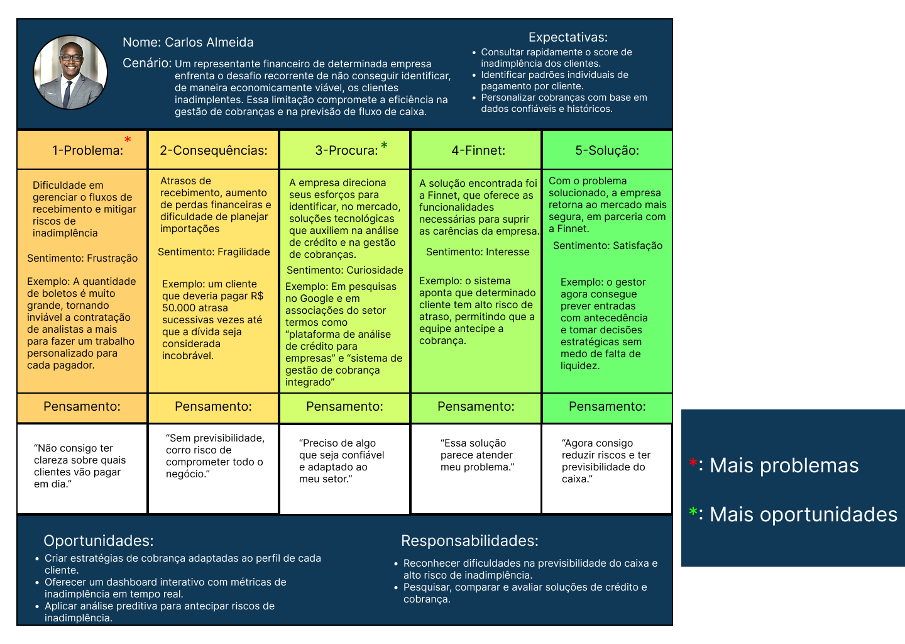

# Documentação Modelo Preditivo - Inteli

```
INSTRUÇÕES GERAIS (remova este trecho ao final)

Você deve editar este documento utilizando notação markdown - siga as convenções neste link
https://docs.github.com/en/get-started/writing-on-github/getting-started-with-writing-and-formatting-on-github/basic-writing-and-formatting-syntax
```

## Nome da Solução

### The Seven

#### Integrantes:

- <a href="https://www.linkedin.com/in/christian-de-carvalho-lawrence">Christian de Carvalho Lawrence</a>
- <a href="https://www.linkedin.com/in/isaac-souza-santos/">Isaac Souza Santos</a>
- <a href="https://www.linkedin.com/in/jaime-andrade-de-almeida-0777ba2a5/">Jaime Andrade de Almeida</a>
- <a href="https://www.linkedin.com/in/jo%C3%A3o-pedro-gon%C3%A7alves-corr%C3%AAa-araujo/">João Pedro Gonçalves Corrêa Araujo</a>
- <a href="">Mike Buchsenspaner</a>
- <a href="https://www.linkedin.com/in/vin%C3%ADcius-rangel-marques/">Vinícius Rangel Marques</a>
- <a href="https://www.linkedin.com/in/yan-de-oliveira-ribeiro-0a55a3356/">Yan de Oliveira Ribeiro</a>

## Sumário

[1. Introdução](#c1)

[2. Objetivos e Justificativa](#c2)

[3. Metodologia](#c3)

[4. Desenvolvimento e Resultados](#c4)

[5. Conclusões e Recomendações](#c5)

[6. Referências](#c6)

[Anexos](#attachments)

## <a name="c1"></a>1. Introdução

&nbsp;&nbsp;&nbsp;&nbsp; A Finnet é uma empresa brasileira de médio porte, com um quadro de 201 a 500 colaboradores, que se destaca no mercado de tecnologia financeira pela sua capacidade de oferecer soluções inovadoras e adaptáveis às necessidades do ambiente corporativo. Com o slogan “Somos tecnologia. Multibanco. Integração.”, a companhia atua no desenvolvimento de tecnologias que simplificam e automatizam processos financeiros, promovendo maior eficiência operacional para seus clientes. Sua atuação concentra-se em áreas como Gestão Financeira e Conciliação Bancária, Cobranças, Boletos e Meios de Pagamento, além de Conectividade Financeira por meio de EDI e RPA. Com base nesses segmentos, a Finnet se posiciona como uma TechFin B2B, especializada em soluções que promovem a automação, a integração e a digitalização das rotinas financeiras de empresas de médio e grande porte.

&nbsp;&nbsp;&nbsp;&nbsp; Nesse contexto, um dos principais desafios enfrentados por seus clientes, e que impacta diretamente o trabalho da própria Finnet, é o aumento da inadimplência no mercado nacional. Esse fenômeno compromete a saúde financeira e a previsibilidade de receita de médias e grandes empresas, dificultando o planejamento estratégico e a tomada de decisões. Além disso, a ausência de dados estruturados, como o histórico de pagamentos e o impacto da inadimplência no fluxo de caixa, prejudica o monitoramento de riscos e a definição de ações corretivas. Para a Finnet, esse cenário representa uma limitação relevante, já que a fragmentação e a complexidade das informações restringem a capacidade de fornecer análises mais aprofundadas, dificultando o apoio efetivo à gestão financeira de seus clientes.

## <a name="c2"></a>2. Objetivos e Justificativa

### 2.1 Objetivos

```
Descreva resumidamente os objetivos gerais e específicos do seu parceiro de negócios.

Remova este bloco ao final
```

### 2.2 Proposta de solução

```
Descreva resumidamente sua proposta de modelo preditivo e como esse modelo pretende resolver o problema, atendendo os objetivos.

Remova este bloco ao final
```

### 2.3 Justificativa

```
Faça uma breve defesa de sua proposta de solução, escreva sobre seus potenciais, seus benefícios e como ela se diferencia.

Remova este bloco ao final
```

## <a name="c3"></a>3. Metodologia

```
Descreva a metodologia CRISP-DM e suas etapas de desenvolvimento, citando o referencial teórico. Você deve apenas enunciar os métodos, sem dizer ainda como eles foram aplicados, nem quais resultados foram obtidos.

Remova este bloco ao final
```

## <a name="c4"></a>4. Desenvolvimento e Resultados

### 4.1. Compreensão do Problema

#### 4.1.1. Contexto da indústria

##### Concorrentes

&nbsp;&nbsp;&nbsp;&nbsp; A Finnet disputa mercado com empresas como **Vindi**, focada em cobrança recorrente; **CobreBemX**, especializada em gestão de boletos e integrações bancárias; e **Celero**, que automatiza rotinas como contas a pagar e conciliação. Também enfrenta concorrência de plataformas como **Asaas** e **Iugu**, que oferecem soluções SaaS voltadas à gestão financeira e integração bancária. No entanto, a Finnet se diferencia por oferecer um portfólio mais amplo e técnico, voltado a empresas de médio e grande porte com alto volume de transações.

##### Modelo de Negócio

A Finnet desenvolve soluções **SaaS** (Software as a Service) para automatizar e integrar processos financeiros empresariais, como:

- Cobrança de clientes
- Pagamento de contas
- Conciliação bancária
- Antecipação de recebíveis

Tudo isso funciona integrado aos bancos por meio de tecnologia própria (**API, EDI e RPA**).

##### Tendências do Setor

&nbsp;&nbsp;&nbsp;&nbsp; O setor financeiro avança com o fortalecimento do **Open Finance**, que amplia o acesso e compartilhamento seguro de dados, e com o uso crescente do **Pix** para agilizar transações empresariais. A adoção da **inteligência artificial (IA)** para análise preditiva tem aprimorado a gestão de riscos e a tomada de decisões. Paralelamente, as novas regulamentações do Banco Central estimulam empresas a investirem em governança sólida e em sistemas integrados que se conectam de forma eficiente ao ambiente bancário.

&nbsp;&nbsp;&nbsp;&nbsp; Diante desse cenário, as empresas buscam cada vez mais soluções seguras, integradas e inteligentes, visando melhorar a previsibilidade financeira, reduzir a inadimplência e otimizar a eficiência dos seus serviços, acompanhando as demandas do mercado e a evolução tecnológica.

---

#### 5 Forças de Porter

&nbsp;&nbsp;&nbsp;&nbsp; As 5 forças de Porter são um framework estratégico utilizado para analisar o setor em que a empresa atua, permitindo uma compreensão aprofundada do ambiente competitivo. Essa ferramenta oferece uma visão detalhada dos fatores que influenciam a rentabilidade e a dinâmica do mercado, proporcionando uma imersão mais completa no contexto em que a empresa está inserida.

##### Ameaça de novos entrantes

**Média** – Embora o setor seja atraente para startups, a entrada de novos concorrentes enfrenta barreiras significativas, como exigências regulatórias rigorosas, incluindo a necessidade de autorização como Instituição de Transação de Pagamento (ITP), a demanda por integração bancária sólida e investimentos substanciais em cibersegurança. Essas condições elevam o nível de complexidade e custo para novos entrantes, protegendo as empresas já estabelecidas.

##### Poder de negociação dos fornecedores

**Baixo** – A Finnet desenvolve suas soluções com base em tecnologia própria, incorporando recursos como APIs para integração ágil entre sistemas, EDI para a troca eletrônica estruturada de dados e RPA para a automação de processos repetitivos. Essa abordagem interna reduz significativamente a necessidade de recorrer a fornecedores externos, o que diminui seu poder de barganha e garante maior controle sobre prazos, custos e qualidade das entregas.

##### Poder de negociação dos compradores

**Alto** – Os clientes da Finnet são, em sua maioria, empresas que realizam um elevado volume de transações financeiras diariamente. Esse perfil lhes confere maior poder de negociação, permitindo discutir de forma mais favorável aspectos como políticas de preços, prazos e níveis de serviço (SLA), além de exigir um grau elevado de personalização das soluções para atender necessidades específicas de integração, automação e segurança.

##### Ameaça de produtos substitutos

**Média** – Algumas empresas ainda recorrem ao uso de planilhas ou ERPs generalistas para gerir suas operações financeiras. No entanto, essas ferramentas costumam apresentar limitações significativas, como a baixa capacidade de automação de processos, integração bancária restrita e mecanismos de controle de risco pouco robustos. Por conta dessas deficiências, sua substituição por soluções mais completas tende a ocorrer apenas em cenários de menor complexidade operacional, nos quais o volume de transações e a necessidade de conformidade regulatória são reduzidos.

##### Rivalidade entre concorrentes existentes

**Alta** - No segmento financeiro, a concorrência é acirrada, com inúmeras fintechs disputando espaço e oferecendo soluções semelhantes. Apesar desse cenário competitivo, a Finnet se diferencia por entregar um alto nível de automação, capaz de otimizar processos e reduzir custos operacionais para seus clientes. Além disso, mantém parcerias estratégicas que ampliam seu alcance e fortalecem seu portfólio de serviços, ao mesmo tempo em que garante uma integração sólida e eficiente com o ecossistema bancário, assegurando conformidade regulatória, agilidade nas transações e maior segurança nas operações.

#### 4.1.2. Análise SWOT

&nbsp;&nbsp;&nbsp;&nbsp; A realização de uma análise SWOT identificando Forças, Fraquezas, Oportunidades e Ameaças é essencial para estruturar com eficácia o
desenvolvimento de um modelo preditivo em parceria com a Finnet Tecnologias. Essa metodologia estratégica oferece um panorama claro do
posicionamento da empresa, permitindo o alinhamento do projeto aos seus pontos fortes, desafios internos e ao contexto competitivo do mercado financeiro.

<div align="center">
<sub>Figura 1: Análise SWOT.</sub>
</div>
<div align="center">

</div>

<div align="center">
<sub>Fonte: Material produzido pela equipe, 2025.</sub>
</div>
<br>

&nbsp;&nbsp;&nbsp;&nbsp; Com essa base, a análise SWOT pode orientar o projeto de modelo preditivo ao explorar:

**Forças:** expertise consolidada em integração com ERPs, robustez das soluções multibanco/multiempresas e pioneirismo em produtos como Bolepix e Open Finance.

**Fraquezas:** possíveis pontos de fragilidade podem incluir dependência de infraestrutura legada dos clientes, ciclos de adoção de inovações e a necessidade de customização intensa para diferentes ERPs e setores.

**Oportunidades:** o crescente ambiente regulatório e de inovação em pagamentos digitais, expansão do ecossistema Open Finance e potencial de uso de dados para previsão de inadimplência, comportamento de pagamentos ou risco na cadeia de fornecedores.

**Ameaças:** concorrência crescente de fintechs e grandes provedores de serviços financeiros, mudanças regulatórias rápidas e riscos relacionados à segurança da informação e conformidade com LGPD.

&nbsp;&nbsp;&nbsp;&nbsp; Ao analisar essas dimensões, torna-se possível estruturar um modelo preditivo direcionado a maximizar os benefícios para a Finnet, como o aprimoramento na tomada de decisões financeiras, a antecipação de possíveis riscos e o incremento na personalização das soluções oferecidas. Dessa forma, garante-se que o projeto não apenas esteja alinhado às diretrizes estratégicas da Finnet, mas também promova um impacto substancial e sustentável em longo prazo.

#### 4.1.3. Planejamento Geral da Solução

&nbsp;&nbsp;&nbsp;&nbsp; A solução é baseada em uma base de dados de pagadores, contendo histórico de boletos, status de liquidação, datas de vencimento, bancos emissores, endereços dos devedores, dados dos recebedores e registros de interações anteriores entre pagadores e a instituição, como número e data dos contatos realizados.

&nbsp;&nbsp;&nbsp;&nbsp; A partir dessa base, será desenvolvido um modelo preditivo que fornecerá aos clientes da Finnet insights como: score de risco de inadimplência, tendência de pagamento, previsão de recebimentos no período e a melhor janela provável de pagamento. Esses dados preditivos visam apoiar decisões estratégicas em processos de cobrança e gestão financeira.

&nbsp;&nbsp;&nbsp;&nbsp; Inicialmente, a solução será disponibilizada como uma **Prova de Conceito (POC)** para integração na plataforma Luna, utilizada para emissão de cobranças e gestão de recebíveis por instituições financeiras ou empresas com alto volume de transações. O produto será entregue por meio de um script em Python, possibilitando que gestores financeiros acessem os insights preditivos diretamente em seu fluxo de trabalho.
Em fases futuras, a solução será incorporada de forma nativa na plataforma, permitindo automações com base nas predições e visualizações em tempo real.

**Benefício esperados da solução:**

- **Redução do risco de inadimplência**, garantindo uma maior previsibilidade de comportamento dos pagadores.
- **Aumento da eficiência operacional**, ao priorizar estratégias de cobranças e renegociações.
- **Melhor previsibilidade de fluxo de caixa**, com projeções de recebimentos mais assertivas.
- **Aprimoramento da comunicação com o cliente final**, baseada em dados históricos e interações anteriores.
- **Valor agregado à plataforma da parceira**, posicionando a empresa como fornecedora de soluções financeiras com inteligência preditiva.

**O sucesso da solução será medido por meio dos seguintes critérios:**

- **Acurácia das predições**: Porcentagem de assertividade nas projeções de inadimplência satisfatória, conforme métricas definidas durante o desenvolvimento.
- **Usabilidade e aderência**: validação positiva por parte dos stakeholders e usuários-chave (gerentes financeiros e coordenadores de contas a receber) durante testes e apresentações.
- **Relevância dos insights**: feedback qualitativo dos usuários demonstrando utilidade prática para tomadas de decisões reais.
- **Viabilidade de escalabilidade**: capacidade técnica de aplicar o modelo a diferentes clientes e setores com necessidade mínima de customização.
- **Níveis de segurança compatíveis com a LGPD**: o tratamento de dados pessoais deverá respeitar os princípios da Lei Geral de Proteção de Dados (LGPD)

#### 4.1.4. Value Proposition Canvas

&nbsp;&nbsp;&nbsp;&nbsp; Com o objetivo de alinhar a oferta do produto ou serviço às necessidades e expectativas da Finnet, foi elaborado o Canva Proposta de Valor da solução. Ele busca garantir que a equipe entregue valor real à empresa parceira, a partir de uma compreensão aprofundada do perfil do cliente, das suas principais dores e dos ganhos que a proposta é capaz de gerar. Assim, assegura-se que o desenvolvimento e a entrega da solução estejam diretamente conectados às demandas estratégicas e operacionais da Finnet.

<div align="center">
<sub>Figura 2: Canva Proposta de Valor.</sub>
</div>
<div align="center">

</div>

<div align="center">
<sub>Fonte: Material produzido pela equipe, 2025.</sub>
</div>
<br>

&nbsp;&nbsp;&nbsp;&nbsp; Através da análise realizada pela equipe, identificamos que a solução deve entregar como:

#### Solução

**Produtos e Serviços**

&nbsp;&nbsp;&nbsp;&nbsp; A solução têm como objetivo criar uma POC (Prova de conceito) que utilize de um modelo de análise preditiva, que recebe os dados coletados pela empresa parceira de boletos anteriores (pagos ou não pagos), e calcule possíveis resultados para boletos futuros ou pendentes, tais como:

- **Calculo do score de risco de inadimplência, através da análise e predição**: Através da análise de boletos anteriores, a solução deve entregar qual o risco de inadimplência de um determinado pagador, a fim de identificar se o boleto será pago ou não.
- **Predição da melhor data de vencimento para cada pagador**: O sistema deve utilizar das datas de pagamentos e inclusão do boleto para calcular qual a melhor data de vencimento possível para determinado pagador.
- **Projeção da tendência de pagamento (em dia, em atraso, inadimplente) do devedor através da análise de boletos anteriores**: A solução deve calcular qual a tendência de pagamento do devedor através da análise dos boletos anteriores.
- **Entrega da projeção de inadimplência (porcentagem e valores) por período**: O sistema deve calcular o valor e porcentagem de inadimplência em um período.
- **Projeção de recebimentos no período analisado**: Calcular uma projeção do valor a ser recebido pelos clientes da Finnet em um determinado período.

**Aliviadores de Dores**

- **Automatização da análise de risco, comportamento de pagamento**: Automatizar a análise de risco de inadimplência e o comportamento de possíveis novos boletos, dados estes que eram calculados de forma manual, pouco eficaz ou não existiam.
- **Redução do tempo e esforço necessários para análise de inadimplência e dados recebidos**: Reduzir o tempo e esforço necessários pela empresa parceira para análise de inadimplência e dados recebidos, que prejudica o fluxo de recebimentos.
- **Melhora nas decisões e estratégias de cobrança**: Melhorar as decisões e estratégias de cobrança de boletos da empresa parceira através das predições de inadimplência.
- **Apoio na negociação de prazos e decisões financeiras baseadas em dados reais**: A plataforma deve prever novos prazos de vencimentos através na análise de dados anteriores, assim auxiliando na negociação dos prazos de pagamentos de boletos e decisões financeiras de recebimento da empresa.

**Criadores de Ganhos**

- **Melhora nas datas de vencimento**: O cálculo de prazos de vencimento gera autonomia para o parceiro na estipulação de novas datas de vencimento possíves, assim prevendo a melhor janela de pagamento possível.
- **Maior autonomia e assertividade do time financeiro na tomada de decisões**: Melhoria na tomada de decisões do parceira através da predição da tendência de pagamento do cliente (em dia, com atraso ou inadimplente).
- **Otimização das estratégias de cobrança de boletos**: A predição do score de risco de inadimplêmcia gera otimização das estratégias de cobrança de boletos, o que gera ganhos reais ao parceiro.
- **Menor impacto no fluxo de caixa do cliente**: Através do cálculo de projeções de recebimentos, há a diminuição do impacto da inadimplência no fluxo de caixa dos clientes, o que gera ganhos para os parceiros da Finnet.

#### Empresa

**Dores**

- **Dificuldade na tomada de decisões em relação a inadimplência**: Uma das maiores dores da Finnet é a dificuldade na tomada de decisões, uma vez que os dados não possuem uma análise e tratamento adequado para transformá-los em possíveis ganhos para a empresa. Além disso, a falta de embasamento para tomada de decisões é um problema crescente no mercado nacional.
- **Falta de informações sobre tendência de pagamento**: A falta de informações sobre a tendência de pagamentos é um problema recorrente na Finnet que causa impacto no fluxo de recebimentos das instituições parceiras, já que não há previsibilidade se o devedor realmente irá pagar o boleto ou não.
- **Decisões pouco embasadas sobre prazos e estratégias de cobrança**: A falta de automatização na análise dos prazos de pagamentos passados dos clientes causam decisões pouco embasadas e dificuldades nas estratégias para cálculo do melhor prazo de vencimento possível para cada vendedor.

- **Alto tempo gasto para analisar dados de recebíveis**: Os dados recebidos atualmente levam um grande tempo gasto para serem análisados de forma manual, além de trazer pouca precisão e confiabilidade nos resultados.

**Ganhos**

- **Maior estabilidade e previsibilidade financeira**: A projeção de recibimentos e predição da inadimplência geram maior estabilidade financeira tanto para a Finnet, quanto para seus clientes, já que melhora o fluxo de caixa e recebimento.
- **Melhor janela para vencimento e cobrança**: A predição da melhor data de vencimento e cobrança gera beneficios como o aumento da taxa de pagamento em dia, redução da inadimplência, otimização do fluxo de caixa e melhoria no relacionamento com o cliente.
- **Redução de inadimplência**: A análise preditiva e o ajuste de estratégias de cobrança permitem identificar riscos antecipadamente e manter a saúde financeira tanto da empresa, quanto de seus parceiros.
- **Proporcionar autonomia na tomada de decisões ao gestor da área financeira**: O acesso a projeções e estatísticas confiáveis permite que o gestor tome decisões estratégicas com mais segurança, agilidade e independência, reduzindo a dependência de processos manuais.
- **Adicionar valor ao produto oferecido ao mercado**: A incorporação de análises preditivas e inteligência financeira ao produto aumenta sua atratividade, diferenciação competitiva e percepção de qualidade, fortalecendo o posicionamento da marca e potencializando oportunidades de novas assinaturas de seu serviço.
- **Aumento dos pagamentos em dia**: O uso de modelos preditivos contribui para aumentar a realização dos pagamentos, por meio da identificação da data de vencimento mais adequada para cada cliente.

**Tarefas do Cliente**

- **Melhorar a projeção de recebimentos**: Uma das tarefas da Finnet com seus clientes é melhorar a projeção de recebimentos.
- **Ajustar datas de vencimento com base em dados**: Ajustar as datas de vencimento através com análise de pagamentos anteriores aumenta a atratividade da empresa e pode gerar novas assinaturas do seu serviço.
- **Prever inadimplência de clientes/pagadores**: A falta de previsões em relação a indimplência dos pagadores é um problema recorrente na empresa e implementação dessa tecnologia pode melhorar a relação da Finnet com seus clientes.
- **Estar informado sobre a tendência de pagamento**: Atualmente, a Finnet não possui nenhuma previsão em relação a tendência de pagamento do devedor, o que causa impacto no fluxo de recebimentos.

&nbsp;&nbsp;&nbsp;&nbsp; A criação do Canva Proposta de Valor permitiu alinhar de forma clara e estratégica as funcionalidades da solução às necessidades reais da Finnet e de seus clientes. A análise aprofundada das dores, ganhos e tarefas do cliente evidenciou que a aplicação de inteligência preditiva na análise de boletos não apenas automatiza processos antes manuais e imprecisos, mas também amplia a assertividade das decisões financeiras, otimiza o fluxo de caixa e fortalece o posicionamento competitivo da empresa. Dessa forma, a proposta apresentada vai além de resolver problemas imediatos, consolidando-se como um diferencial estratégico capaz de gerar valor contínuo, reduzir riscos e potencializar oportunidades de crescimento para a Finnet e seus parceiros.

A modelo do Canva Proposta de Valor está disponível em: https://www.canva.com/design/DAGvOr-iSA0/j7zPQIjIGNRC4wTqqMU_pw/edit?utm_content=DAGvOr-iSA0&utm_campaign=designshare&utm_medium=link2&utm_source=sharebutton

#### 4.1.5. Matriz de Riscos

&nbsp;&nbsp;&nbsp;&nbsp; A matriz de risco é uma ferramenta visual utilizada para identificar, classificar e priorizar riscos ou oportunidades com base na probabilidade de ocorrência e no impacto que podem causar no projeto ou na organização. Ela permite que as equipes tomem decisões mais assertivas, direcionando esforços para lidar primeiro com os pontos mais críticos.
No caso do nosso projeto, a matriz foi aplicada para mapear oportunidades relacionadas à previsão de inadimplência e à melhoria da gestão de recebíveis da Finnet. Os riscos e oportunidades foram posicionados nos quadrantes de acordo com sua probabilidade (Alta, Média ou Baixa) e impacto (Alto, Médio ou Baixo).
Uma das oportunidades identificadas como Alta probabilidade / Alto impacto foi a melhoria na previsão de inadimplência para reduzir perdas, já que isso afeta diretamente a eficiência na cobrança e os resultados financeiros.

<div align="center">
<sub>Figura 3: Matriz de Risco.</sub>
</div>
<div align="center">


</div>

<div align="center">
<sub>Fonte: Material produzido pela equipe, 2025.</sub>
</div>
<br>

&nbsp;&nbsp;&nbsp;&nbsp; A implementação da matriz de risco no projeto desempenhou um papel fundamental ao possibilitar a priorização das ações consideradas mais relevantes para o alcance dos objetivos propostos. Além disso, o uso dessa ferramenta se mostrou eficaz para promover um alinhamento claro dentro da equipe, facilitando a identificação das oportunidades que demandam ações mais urgentes, bem como dos possíveis riscos que exigem monitoramento contínuo e estratégias adequadas de mitigação.

##### Ameaças

1. **Previsão imprecisa do fluxo de recebimentos**:

&nbsp;&nbsp;&nbsp;&nbsp; A projeção incorreta do fluxo de caixa pode comprometer diretamente a saúde financeira dos clientes da Finnet, afetando decisões como pagamentos de fornecedores, funcionários, dívidas e investimentos. Uma previsão mal calibrada pode levar a déficits operacionais ou má alocação de recursos.

2. **Erro significativo no score de inadimplência**:

&nbsp;&nbsp;&nbsp;&nbsp; O score de risco de inadimplência orienta decisões cruciais, como concessão de crédito ou prazos de pagamento. Altas taxas de erro neste indicador podem gerar perdas financeiras relevantes, sobretudo em setores onde o risco de crédito é fator-chave, como instituições financeiras, empresas de cobrança e consórcios.

3. **Janela de pagamento subótima**

&nbsp;&nbsp;&nbsp;&nbsp; Indicar uma janela de pagamento que não considera o comportamento real ou a rotina financeira do devedor (como a data de recebimento de salário) pode reduzir as chances de recebimento, comprometendo a eficácia da cobrança.

4. **Tendência de pagamento classificada incorretamente**

&nbsp;&nbsp;&nbsp;&nbsp; Uma categorização equivocada do pagador como “em dia”, “com atraso” ou “inadimplente” pode distorcer o perfil de risco atribuído, gerando decisões inadequadas de cobrança ou concessão de crédito.

5. **Dependência excessiva de dados históricos**

&nbsp;&nbsp;&nbsp;&nbsp; Modelos preditivos baseados unicamente em dados históricos podem falhar diante de mudanças no contexto econômico, comportamental ou regulatório. Essa limitação afeta a capacidade de adaptação do sistema a novos padrões de comportamento dos pagadores.

6. **Baixa aceitação ou adoção da funcionalidade**

&nbsp;&nbsp;&nbsp;&nbsp; Mesmo que os modelos estejam tecnicamente corretos, a falta de transparência, explicabilidade ou integração com os fluxos do cliente pode gerar desconfiança e baixa adoção. Isso limita o valor percebido da funcionalidade e reduz o impacto do projeto.

7. **Qualidade e atualização insuficiente da base de dados**:

&nbsp;&nbsp;&nbsp;&nbsp; Informações desatualizadas, incompletas ou fora da distribuição esperada comprometem a qualidade das análises geradas. A confiabilidade dos insights depende diretamente da integridade e frescor dos dados utilizados.

##### Oportunidades

1. **Melhorar a previsão de inadimplência para reduzir perdas**

&nbsp;&nbsp;&nbsp;&nbsp; É o objetivo central da POC. Com bons dados, a previsão de inadimplência evita perdas financeiras diretas para os clientes, agregando valor imediato à solução.

2. **Aumentar a eficiência na cobrança (agindo no momento certo)**

&nbsp;&nbsp;&nbsp;&nbsp; Com uma boa previsão, é possível antecipar ações de cobrança no momento ideal, o que aumenta a taxa de sucesso no recebimento.

3. **Facilitar a tomada de decisão dos gestores financeiros**

&nbsp;&nbsp;&nbsp;&nbsp; Um dashboard simples com insights preditivos já melhora significativamente a rotina e o desempenho dos gestores financeiros.

4. **Melhorar a satisfação dos clientes por oferecer informações mais úteis**

&nbsp;&nbsp;&nbsp;&nbsp; Entregar dados preditivos relevantes aumenta o valor percebido da solução e contribui para uma melhor experiência de uso.

5. **Melhoria de processos internos**

&nbsp;&nbsp;&nbsp;&nbsp; A própria Finnet pode aplicar os resultados da POC para otimizar seus produtos e processos. A aplicação é simples, mas o impacto é mais localizado.

6. **Diferenciação competitiva no mercado de gestão de recebíveis**

&nbsp;&nbsp;&nbsp;&nbsp; Caso a solução final seja bem posicionada e entregue resultados sólidos, a Finnet pode se destacar no mercado por oferecer recursos preditivos avançados.

7. **Atrair novos clientes interessados em ferramentas preditivas**

&nbsp;&nbsp;&nbsp;&nbsp; Ao oferecer uma solução robusta e inovadora, há um grande potencial para criar novas oportunidades de negócios, principalmente junto a empresas que priorizam a utilização estratégica de inteligência de dados.

#### 4.1.6. Personas

##### Pessoa Jurídica

<div align="center">
<sub align="center">Figure 4 – Persona - Pessoa Jurídica</sub>
</div>

<div align="center">

</div>

<div align="center">
<sup>Fonte: Produzido pelo grupo, 2025.</sup>
</div>
<br>

&nbsp;&nbsp;&nbsp;&nbsp; Carlos Almeida representa o perfil do decisor financeiro que busca soluções tecnológicas para otimizar a gestão de crédito e reduzir riscos de inadimplência. Como Chief Financial Officer de uma empresa de grande porte, lida diariamente com o desafio de manter a saúde financeira da organização, equilibrando previsibilidade de caixa, controle de recebimentos e mitigação de perdas. Sua atuação exige acesso rápido a informações confiáveis e ferramentas que apoiem decisões estratégicas baseadas em dados.

#### Gerente Finnet

<div align="center">
<sub align="center">Figura 5 – Persona - Gerente Finnet</sub>
</div>

<div align="center">

</div>

<div align="center">
<sup>Fonte: Produzido pelo grupo, 2025.</sup>
</div>

Rogério Silveira é o perfil de cliente principal do projeto e atua como Gerente Financeiro na Finnet. Ele é responsável por monitorar transações e elaborar relatórios financeiros para empresas parceiras, garantindo que estas tenham uma visão clara e atualizada do seu fluxo de caixa. Com alta afinidade com tecnologia, busca automatizar processos de coleta e análise de dados, reduzindo o trabalho manual e aumentando a precisão das informações. Entre suas principais necessidades está prever a inadimplência e identificar tendências de pagamento, permitindo agir de forma proativa. Atualmente, Rogério deseja agregar valor ao serviço prestado pela Finnet implementando recursos como score de risco de inadimplência, melhor janela provável de pagamento e análise do impacto da inadimplência no fluxo de recebimentos, fortalecendo a tomada de decisão dos clientes e da própria empresa.

#### 4.1.7. Jornadas do Usuário

A escolha pelo uso de journey maps em nosso projeto está diretamente relacionada à necessidade de compreender de forma clara e estruturada a experiência do usuário, especialmente no eixo voltado ao entendimento de UX. Essa ferramenta nos permitiu representar visualmente as etapas percorridas pelo usuário, favorecendo a identificação de pontos de contato relevantes e possíveis dificuldades no processo. Desse modo, torna-se possível projetar com maior precisão como o usuário final fará uso do modelo preditivo desenvolvido em Python, assegurando que a solução proposta seja não apenas tecnicamente eficiente, mas também alinhada às expectativas e necessidades reais de quem irá utilizá-la.

<div align="center">
<sub align="center">Figura 6 – Jornada de Usuário - Pessoa Jurídica</sub>
</div>

<div align="center">

</div>

<div align="center">
<sup>Fonte: Produzido pelo grupo, 2025.</sup>
</div>

A persona escolhida, Carlos Almeida, representa uma pessoa jurídica e reflete os desafios complexos enfrentados por gestores financeiros de empresas, como a dificuldade em gerenciar grandes volumes de recebimentos, mitigar riscos de inadimplência e garantir previsibilidade no fluxo de caixa. Optamos por esse perfil porque ele evidencia problemas organizacionais e estratégicos que não se limitam ao indivíduo, mas impactam diretamente a sustentabilidade do negócio. Dessa forma, o journey map permite mapear desde a frustração inicial até a satisfação com soluções de análise preditiva, dashboards e estratégias personalizadas de cobrança, demonstrando o valor de ferramentas que oferecem clareza, confiabilidade e suporte à tomada de decisão no contexto corporativo.

<div align="center">
<sub align="center">Figura 6 – Jornada de Usuário - Pessoa Finnet</sub>
</div>

<div align="center">

</div>

<div align="center">
<sup>Fonte: Produzido pelo grupo, 2025.</sup>
</div>

Escolhemos essa persona para a criação do journey map porque ela representa diretamente o perfil de cliente que a empresa Finnet busca atender: profissionais da área financeira que enfrentam dificuldades na previsibilidade do fluxo de caixa, no controle da inadimplência e na organização dos recebimentos. Ao adotar a persona de Rogério Silveira, conseguimos retratar de forma clara as dores de um tomador de decisão dentro da empresa, que lida com processos manuais, pouco confiáveis e demorados, gerando insegurança e riscos de perdas financeiras. Esse cenário evidencia não apenas os problemas reais enfrentados, mas também as oportunidades de solução que a Finnet pode oferecer, como automação, previsões confiáveis e redução do trabalho manual. Assim, o journey map se torna uma ferramenta estratégica para compreender a jornada do cliente empresarial, mostrando como as soluções propostas pela Finnet podem transformar frustrações em confiança e satisfação, fortalecendo o posicionamento da empresa como parceira essencial na modernização da gestão financeira.


Em síntese, o uso de journey maps se mostrou fundamental para garantir que o desenvolvimento do modelo preditivo em Python fosse orientado não apenas pela lógica técnica, mas também pela perspectiva do usuário. Ao possibilitar a visualização detalhada da jornada, essa ferramenta contribuiu para antecipar potenciais barreiras, refinar pontos de interação e alinhar a solução às reais necessidades dos futuros usuários. Assim, asseguramos que o projeto alcance maior usabilidade, relevância prática e impacto efetivo no contexto em que será aplicado.

#### 4.1.8 Política de Privacidade

##### Modelo de Política de Privacidade:

Projeto [NOME DO PROJETO]

##### Informações Gerais

&nbsp;&nbsp;&nbsp;&nbsp; Esta política de privacidade informa como o projeto **[NOME DO PROJETO]**, desenvolvido pelo grupo The Seven, trata os dados pessoais coletados durante o uso da solução. Está em conformidade com a Lei nº 13.709/2018 – LGPD.

##### Dados Coletados

A Finnet forneceu os seguintes dados pessoais:

- Id do grupo.
- Id do beneficiário.
- Data de inclusão do pagamento.
- Status do boleto
- Data de vencimento da fatura
- Valor a ser pago pelo beneficiário
- Data de pagamento
- Nome do banco emissor
- Id do pagador
- CEP do pagador.

Não foram fornecidos dados sensíveis sobre os titulares.

##### Dados coletados automaticamente:

- Quantidade de acessos do pagador
- Última data de acesso.

##### Finalidade do Tratamento

&nbsp;&nbsp;&nbsp;&nbsp; Os dados pessoais coletados serão tratados com as seguintes finalidades:

- Garantia do funcionamento da plataforma, permitindo a análise do comportamento de pagamento e a geração de insights preditivos sobre inadimplência;
- Elaboração de estatísticas e projeções, tais como, score de risco de inadimplência, tendência de pagamento (em dia, com
  atraso, inadimplente) e previsão de recebimentos, para apoiar a tomada de decisões da área financeira da empresa parceira.

&nbsp;&nbsp;&nbsp;&nbsp; A utilização desses dados é permitida de acordo com o artigo 7 da LGPD:

- I - mediante o fornecimento de consentimento pelo titular (cliente do parceiro);
- II - para o cumprimento de obrigação legal ou regulatória pelo controlador;
- V - quando necessário para a execução de contrato ou de procedimentos preliminares relacionados a contrato do qual seja parte o titular, a pedido do titular dos dados;
- IX - quando necessário para atender aos interesses legítimos do controlador ou de terceiro, exceto no caso de prevalecerem direitos e liberdades fundamentais do titular que exijam a proteção dos dados pessoais.

&nbsp;&nbsp;&nbsp;&nbsp; Além disso, os dados fornecidos não são identificados como sensíveis ou referentes a menores de idade, portanto, não infringem, de qualquer forma, o artigo 11 da Lei Geral de Proteção de Dados Nº 13.709.

##### Armazenamento e Retenção

&nbsp;&nbsp;&nbsp;&nbsp; Os dados utilizados no projeto serão armazenados em um documento no Drive e repositório no Github para facilitar seu uso.

##### Prazo

&nbsp;&nbsp;&nbsp;&nbsp; O acesso aos dados fornecidos é válido por dois meses e meio, tempo referente a duração do projeto.

##### Compartilhamento de Dados

&nbsp;&nbsp;&nbsp;&nbsp; Os dados e resultados gerados a partir da solução podem ser compartilhados somente com a empresa parceira do projeto.

##### Segurança dos Dados

&nbsp;&nbsp;&nbsp;&nbsp; Para garantir a segurança dos dados, é realizado o controle do acesso, de modo que apenas os envolvidos no projeto têm acesso pleno a eles.

##### Direitos dos Titulares

&nbsp;&nbsp;&nbsp;&nbsp; Os titulares dos dados podem solicitar:

- Acesso aos seus dados;
- Correção de informações incorretas;
- Exclusão de dados;
- Portabilidade de dados;
- Oposição ao tratamento e revogação de consentimento.

&nbsp;&nbsp;&nbsp;&nbsp; Para exercer esses direitos, envie uma solicitação para: govcorp@finnet.com.br.

##### Encarregado de Dados (DPO)

**Nome:** Marília Nascimbeni Buchala <Br>
**E-mail:** mbuchala@gmail.com

### 4.2. Compreensão dos Dados

#### 4.2.1. Exploração de dados

```
Apresentar a estatística descritiva básica de cada coluna, identificar se a coluna é numérica ou categórica e pelo menos 3 gráficos para visualizar a relação entre colunas escolhidas pelo grupo.

Remova este bloco ao final
```

#### 4.2.2. Pré-processamento dos dados

```
Apresentar quais foram as ações realizadas de limpeza (tratamento de missing values e remoção de outliers) e transformação (normalização e codificação) das colunas. Se houverem outliers, cite quais são e qual(is) correção(ões) será(ão) aplicada(s).

Remova este bloco ao final
```

#### 4.2.3. Hipóteses

```
Descreva três hipóteses sobre a relação dos dados e o problema. Justifique cada uma delas.

Remova este bloco ao final
```

### 4.3. Preparação dos Dados e Modelagem

```
Caso seu projeto seja Modelo Supervisionado, apresentar:
a) Organização dos dados (conjunto de treinamento, validação e testes)
b) Modelagem para o problema (proposta de features com a explicação completa da linha de raciocínio).
c) Métricas relacionadas ao modelo (pelo menos 3).
d) Apresentar o primeiro modelo candidato, e uma discussão sobre os resultados deste modelo (discussão sobre as métricas para esse modelo candidato).

Caso seu projeto seja Modelo Não-Supervisionado, apresentar:
a) Modelagem para o problema (proposta de features com a explicação completa da linha de raciocínio).
b) Primeiro modelo candidato para o problema.
c) Justificativa para a definição do K do modelo.
d) Escolha de um tipo de sistema de recomendação e a justificativa para essa escolha.

Remova este bloco ao final
```

### 4.4. Comparação de Modelos

```
- Descrever e justificar a escolha da métrica de avaliação dos modelos com base no que é mais importante para o problema ao
  se medir a qualidade desses modelos;
- Descrever ao menos três modelos candidatos, seus respectivos algoritmos, seus tunings de hiperparâmetros e suas métricas
  alcançadas;

Remova este bloco ao final
```

### 4.5. Avaliação

```
- Descreva a solução final de modelo preditivo e justifique a escolha. Alinhe sua justificativa com a Seção 4.1, resgatando o entendimento
  do negócio e das personas, explicando de que formas seu modelo atende os requisitos e definições.
- Descreva também um plano de contingência para os casos em que o modelo falhar em suas predições.
- Além disso, discuta sobre a explicabilidade do modelo (se aplicável) e realize a verificação de aceitação ou refutação das hipóteses.
- Se aplicável, utilize equações, tabelas e gráficos de visualização de dados para melhor ilustrar seus argumentos.

Remova este bloco ao final
```

## <a name="c5"></a>5. Conclusões e Recomendações

```
Escreva, de forma resumida, sobre os principais resultados do seu projeto e faça recomendações formais ao seu parceiro de negócios em relação ao uso desse modelo. Você pode aproveitar este espaço para comentar sobre possíveis materiais extras, como um manual de usuário mais detalhado na seção “Anexos”. Não se esqueça também das pessoas que serão potencialmente afetadas pelas decisões do modelo preditivo e elabore recomendações que ajudem seu parceiro a tratá-las de maneira estratégica e ética.

Remova este bloco ao final
```

## <a name="c6"></a>6. Referências

## <a name="attachments"></a>Anexos

```
Utilize esta seção para anexar materiais como manuais de usuário, documentos complementares que ficaram grandes e não couberam no corpo do texto etc.

Remova este bloco ao final
```
