# Documentação Modelo Preditivo - Inteli

```
INSTRUÇÕES GERAIS (remova este trecho ao final)

Você deve editar este documento utilizando notação markdown - siga as convenções neste link
https://docs.github.com/en/get-started/writing-on-github/getting-started-with-writing-and-formatting-on-github/basic-writing-and-formatting-syntax
```

## Nome da Solução

### The Seven

#### Integrantes:

- <a href="https://www.linkedin.com/in/christian-de-carvalho-lawrence">Christian de Carvalho Lawrence</a>
- <a href="https://www.linkedin.com/in/isaac-souza-santos/">Isaac Souza Santos</a>
- <a href="https://www.linkedin.com/in/jaime-andrade-de-almeida-0777ba2a5/">Jaime Andrade de Almeida</a>
- <a href="https://www.linkedin.com/in/jo%C3%A3o-pedro-gon%C3%A7alves-corr%C3%AAa-araujo/">João Pedro Gonçalves Corrêa Araujo</a>
- <a href="">Mike Buchsenspaner</a>
- <a href="https://www.linkedin.com/in/vin%C3%ADcius-rangel-marques/">Vinícius Rangel Marques</a>
- <a href="https://www.linkedin.com/in/yan-de-oliveira-ribeiro-0a55a3356/">Yan de Oliveira Ribeiro</a>

## Sumário

[1. Introdução](#c1)

[2. Objetivos e Justificativa](#c2)

[3. Metodologia](#c3)

[4. Desenvolvimento e Resultados](#c4)

[5. Conclusões e Recomendações](#c5)

[6. Referências](#c6)

[Anexos](#attachments)

## <a name="c1"></a>1. Introdução

&nbsp;&nbsp;&nbsp;&nbsp; A Finnet é uma empresa brasileira de médio porte, com um quadro de 201 a 500 colaboradores, que se destaca no mercado de tecnologia financeira pela sua capacidade de oferecer soluções inovadoras e adaptáveis às necessidades do ambiente corporativo. Com o slogan “Somos tecnologia. Multibanco. Integração.”, a companhia atua no desenvolvimento de tecnologias que simplificam e automatizam processos financeiros, promovendo maior eficiência operacional para seus clientes. Sua atuação concentra-se em áreas como Gestão Financeira e Conciliação Bancária, Cobranças, Boletos e Meios de Pagamento, além de Conectividade Financeira por meio de EDI e RPA. Com base nesses segmentos, a Finnet se posiciona como uma TechFin B2B, especializada em soluções que promovem a automação, a integração e a digitalização das rotinas financeiras de empresas de médio e grande porte.

&nbsp;&nbsp;&nbsp;&nbsp; Nesse contexto, um dos principais desafios enfrentados por seus clientes, e que impacta diretamente o trabalho da própria Finnet, é o aumento de pagadores inadimplentes no mercado nacional. Esse fenômeno compromete a saúde financeira e a previsibilidade de receita de médias e grandes empresas, dificultando o planejamento estratégico e a tomada de decisões. Além disso, a ausência de dados estruturados, como o histórico de pagamentos e o impacto da inadimplência no fluxo de caixa, prejudica o monitoramento de riscos e a definição de ações corretivas. Para a Finnet, esse cenário representa uma limitação relevante, já que a fragmentação e a complexidade das informações restringem a capacidade de fornecer análises mais aprofundadas, dificultando o apoio efetivo à gestão financeira de seus clientes.

## <a name="c2"></a>2. Objetivos e Justificativa

### 2.1 Objetivos

```
Descreva resumidamente os objetivos gerais e específicos do seu parceiro de negócios.

Remova este bloco ao final
```

### 2.2 Proposta de solução

```
Descreva resumidamente sua proposta de modelo preditivo e como esse modelo pretende resolver o problema, atendendo os objetivos.

Remova este bloco ao final
```

### 2.3 Justificativa

```
Faça uma breve defesa de sua proposta de solução, escreva sobre seus potenciais, seus benefícios e como ela se diferencia.

Remova este bloco ao final
```

## <a name="c3"></a>3. Metodologia

<br>
A metodologia CRISP-DM (Cross Industry Standard Process for Data Mining) é um modelo de referência amplamente utilizado em projetos de mineração de dados, criado para oferecer um processo estruturado, padronizado e flexível. Segundo Chapman et al. (2000), trata-se de uma abordagem cíclica que organiza o trabalho em fases bem definidas, favorecendo tanto a compreensão dos dados quanto a transformação destes em conhecimento útil para a tomada de decisão.
<br>

O processo é dividido em seis fases interdependentes, que vão do entendimento do problema até a implantação dos resultados:

### 3.1 Entendimento do negócio:

Nesta fase, busca-se compreender o problema a partir da perspectiva organizacional. O foco não está nos dados em si, mas nos objetivos estratégicos da empresa ou instituição. É aqui que se define claramente o propósito do projeto e os requisitos de sucesso.
Exemplo: em uma rede de varejo, o objetivo pode ser reduzir a taxa de abandono de clientes (churn). A equipe de ciência de dados precisa entender o que “retenção” significa para o negócio, quais métricas indicam sucesso e quais restrições existem (como orçamento ou tempo).
  
### 3.2 Entendimento dos dados:

Uma vez definido o problema, inicia-se a coleta inicial e a exploração dos dados disponíveis. Esta etapa envolve identificação das fontes, análise de qualidade, descoberta de valores faltantes ou inconsistentes e observação de padrões preliminares.
Exemplo: ao analisar os dados de clientes de uma empresa de telecomunicações, pode-se perceber que há campos em branco nas informações de idade, ou que o histórico de chamadas mostra picos de cancelamentos em determinados meses.
  
### 3.3 Preparação dos dados:

Depois da exploração, os dados precisam ser organizados em um formato adequado para a análise. Isso envolve limpeza, integração, transformação e seleção de variáveis relevantes. É comum que essa fase seja a mais trabalhosa, consumindo grande parte do esforço em um projeto de ciência de dados.
Exemplo: normalizar colunas de preços, tratar valores ausentes substituindo-os por médias ou medianas, converter datas em períodos (como trimestre/ano) e criar variáveis derivadas, como “tempo de contrato”.
  
### 3.4 Modelagem:

Com os dados preparados, aplicam-se diferentes técnicas de modelagem, como regressão, árvores de decisão, redes neurais, clustering ou séries temporais. É comum experimentar mais de um algoritmo e ajustar parâmetros (hiperparâmetros) para encontrar o melhor desempenho.
Exemplo: para prever churn, pode-se comparar o resultado de um modelo de regressão logística com o de uma árvore de decisão, analisando qual apresenta maior precisão e menor taxa de falsos positivos.

### 3.5 Avaliação:

Mesmo que o modelo apresente bons resultados em métricas estatísticas, é fundamental verificar sua aderência aos objetivos do negócio. Nesta fase, revisa-se se as descobertas realmente ajudam a responder ao problema original e se não existem riscos de interpretações equivocadas.
Exemplo: um modelo pode prever corretamente 85% dos cancelamentos de clientes, mas se não indicar quem são os clientes mais valiosos, pode não atender à necessidade da empresa, que prioriza manter clientes de alto gasto.

### 3.6 Implantação:

Na última fase, os resultados são integrados ao contexto real, permitindo que o conhecimento extraído gere valor efetivo. A implantação pode variar desde a criação de um relatório analítico até a implementação de um sistema automatizado de predição em tempo real.
Exemplo: no caso do churn, o modelo pode ser incorporado ao CRM da empresa, alertando a equipe de marketing quando um cliente apresenta alta probabilidade de cancelamento, possibilitando campanhas de retenção personalizadas.

### Observação:

É importante destacar que o CRISP-DM não deve ser interpretado como um processo linear e estático. Ao contrário, trata-se de um ciclo iterativo e adaptável, no qual os resultados de uma fase podem levar à revisão das anteriores. Por exemplo, durante a modelagem pode-se perceber que faltam dados importantes, exigindo um retorno à fase de preparação ou até mesmo ao entendimento do negócio.
<br>

## <a name="c4"></a>4. Desenvolvimento e Resultados

### 4.1. Compreensão do Problema

#### 4.1.1. Contexto da indústria

##### Concorrentes

&nbsp;&nbsp;&nbsp;&nbsp; A Finnet disputa mercado com empresas como **Vindi**, focada em cobrança recorrente; **CobreBemX**, especializada em gestão de boletos e integrações bancárias; e **Celero**, que automatiza rotinas como contas a pagar e conciliação. Também enfrenta concorrência de plataformas como **Asaas** e **Iugu**, que oferecem soluções SaaS voltadas à gestão financeira e integração bancária. No entanto, a Finnet se diferencia por oferecer um portfólio mais amplo e técnico, voltado a empresas de médio e grande porte com alto volume de transações.

##### Modelo de Negócio

A Finnet desenvolve soluções **SaaS** (Software as a Service) para automatizar e integrar processos financeiros empresariais, como:

- Cobrança de clientes
- Pagamento de contas
- Conciliação bancária
- Antecipação de recebíveis

Tudo isso funciona integrado aos bancos por meio de tecnologia própria (**API, EDI e RPA**).

##### Tendências do Setor

&nbsp;&nbsp;&nbsp;&nbsp; O setor financeiro avança com o fortalecimento do **Open Finance**, que amplia o acesso e compartilhamento seguro de dados, e com o uso crescente do **Pix** para agilizar transações empresariais. A adoção da **inteligência artificial (IA)** para análise preditiva tem aprimorado a gestão de riscos e a tomada de decisões. Paralelamente, as novas regulamentações do Banco Central estimulam empresas a investirem em governança sólida e em sistemas integrados que se conectam de forma eficiente ao ambiente bancário.

&nbsp;&nbsp;&nbsp;&nbsp; Diante desse cenário, as empresas buscam cada vez mais soluções seguras, integradas e inteligentes, visando melhorar a previsibilidade financeira, reduzir a inadimplência e otimizar a eficiência dos seus serviços, acompanhando as demandas do mercado e a evolução tecnológica.

---

#### 5 Forças de Porter

&nbsp;&nbsp;&nbsp;&nbsp; As 5 forças de Porter são um framework estratégico utilizado para analisar o setor em que a empresa atua, permitindo uma compreensão aprofundada do ambiente competitivo. Essa ferramenta oferece uma visão detalhada dos fatores que influenciam a rentabilidade e a dinâmica do mercado, proporcionando uma imersão mais completa no contexto em que a empresa está inserida.

##### Ameaça de novos entrantes

**Média** – Embora o setor seja atraente para startups, a entrada de novos concorrentes enfrenta barreiras significativas, como exigências regulatórias rigorosas, incluindo a necessidade de autorização como Instituição de Transação de Pagamento (ITP) (MARCAS E MERCADOS, 2024), a demanda por integração bancária sólida e investimentos substanciais em cibersegurança. Essas condições elevam o nível de complexidade e custo para novos entrantes, protegendo as empresas já estabelecidas.
Além disso, o Banco Central do Brasil tem endurecido normas de governança, compliance e segurança digital para instituições financeiras, exigindo robustos controles contra fraudes, relatórios de conformidade e certificações em segurança da informação. Isso significa que, mesmo que startups consigam atrair clientes com soluções inovadoras, o custo regulatório pode inviabilizar a escala. Por outro lado, o crescimento do ecossistema Open Finance no Brasil pode abrir brechas para novas fintechs, especialmente as que atuam em nichos de análise de dados e prevenção de fraudes, o que mantém a pressão competitiva em nível médio (BCB, 2017; BCB, 2025; EY, 2025).

##### Poder de negociação dos fornecedores

**Baixo** – A Finnet desenvolve suas soluções com base em tecnologia própria, incorporando recursos como APIs para integração ágil entre sistemas, EDI para a troca eletrônica estruturada de dados e RPA para a automação de processos repetitivos (FINNET, 2024a; LEADIQ, 2024). Essa abordagem interna reduz significativamente a necessidade de recorrer a fornecedores externos, o que diminui seu poder de barganha e garante maior controle sobre prazos, custos e qualidade das entregas.
No entanto, é importante ressaltar que, embora o núcleo tecnológico seja proprietário, a Finnet ainda depende da infraestrutura bancária nacional e da regulamentação do Banco Central para viabilizar suas integrações. Isso significa que fornecedores estratégicos, como bancos parceiros e provedores de nuvem (AWS, Azure, etc.), podem ter alguma influência indireta, principalmente em questões de custos de processamento e armazenamento de dados. Ainda assim, esse poder é diluído, pois a Finnet consegue negociar com múltiplos parceiros e diversificar sua base tecnológica.

##### Poder de negociação dos compradores

**Alto** – Os clientes da Finnet são, em sua maioria, empresas que realizam um elevado volume de transações financeiras diariamente. Esse perfil lhes confere maior poder de negociação, permitindo discutir de forma mais favorável aspectos como políticas de preços, prazos e níveis de serviço, além de exigir um grau elevado de personalização das soluções para atender necessidades específicas de integração, automação e segurança (PwC & ABFintechs, 2025; Falando de Negócio, 2025).

##### Ameaça de produtos substitutos

**Média** – Algumas empresas ainda recorrem ao uso de planilhas ou ERPs generalistas para gerir suas operações financeiras. No entanto, essas ferramentas costumam apresentar limitações significativas, como a baixa capacidade de automação de processos, integração bancária restrita e mecanismos de controle de risco pouco robustos. Por conta dessas deficiências, sua substituição por soluções mais completas tende a ocorrer apenas em cenários de menor complexidade operacional, nos quais o volume de transações e a necessidade de conformidade regulatória são reduzidos (INFOMONEY, 2025; RIMINI STREET & KEARNEY, 2024; FOURBANK, 2025).

##### Rivalidade entre concorrentes existentes

**Alta** - No segmento financeiro, a concorrência é acirrada, com inúmeras fintechs, como Celcoin, Matera e Pismo têm avançado em soluções de infraestrutura financeira, aumentando a rivalidade e pressionando players como a Finnet a investir continuamente em inovação disputando espaço e oferecendo soluções semelhantes. 
Porém, apesar desse cenário competitivo, a Finnet movimentou R$ 1,6 trilhão em transações em 2023 e se diferencia por entregar um alto nível de automação, capaz de otimizar processos e reduzir custos operacionais para seus clientes (OLHAR DIGITAL, 2024; CANAL EXECUTIVO, 2024).

#### 4.1.2. Análise SWOT

&nbsp;&nbsp;&nbsp;&nbsp; A realização de uma análise SWOT identificando Forças, Fraquezas, Oportunidades e Ameaças é essencial para estruturar com eficácia o
desenvolvimento de um modelo preditivo em parceria com a Finnet Tecnologias. Essa metodologia estratégica oferece um panorama claro do
posicionamento da empresa, permitindo o alinhamento do projeto aos seus pontos fortes, desafios internos e ao contexto competitivo do mercado financeiro.

<br>
<div align="center">
<sub>Figura 1: Análise SWOT.</sub>
</div>
<br>
<div align="center">
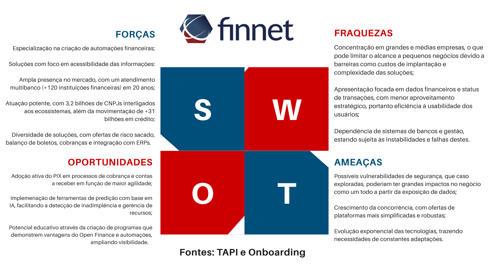
</div>
<br>
<div align="center">
<sub>Fonte: Material produzido pelo grupo The Seven, 2025.</sub>
</div>
<br>

&nbsp;&nbsp;&nbsp;&nbsp; Com essa base, a análise SWOT pode orientar o projeto de modelo preditivo ao explorar:

- **Forças:** expertise consolidada na criação de automações financeiras e integração com ERPs; ampla rede de atendimento multibanco (+120 instituições), que assegura capilaridade; soluções reconhecidas no mercado, como Bolepix e integrações em Open Finance; além de uma forte base de dados transacionais, com potencial para treinar modelos de previsão de inadimplência.

- **Fraquezas:** Concentração em clientes de médio e grande porte, o que limita o alcance às PMEs que poderiam se beneficiar do modelo; dependência de sistemas bancários e de gestão, sujeitando-se a instabilidades externas e necessidade de alto nível de customização para diferentes setores e ERPs, fator que pode comprometer a escalabilidade da plataforma Luna, voltada à gestão e predição de recebimentos.

- **Oportunidades:** o ambiente regulatório e de inovação em pagamentos digitais, impulsionado pelo avanço do uso do PIX em cobranças e contas a receber, cria novas bases para análises preditivas. Soma-se a isso a expansão do ecossistema Open Finance, que amplia o acesso a informações relevantes para modelos de risco de crédito e inadimplência, possibilitando o desenvolvimento de relatórios estratégicos capazes de antecipar padrões de comportamento de pagamento e agregar valor direto aos clientes.

- **Ameaças:** aceleração da concorrência, com soluções mais simplificadas e acessíveis; mudanças regulatórias rápidas, que podem impactar a modelagem de dados e riscos relacionados à segurança e à conformidade com a LGPD, especialmente críticos em modelos que utilizam dados financeiros sensíveis.

&nbsp;&nbsp;&nbsp;&nbsp; Ao analisar essas dimensões, torna-se possível estruturar um modelo preditivo direcionado a maximizar os benefícios para a Finnet, como o aprimoramento na tomada de decisões financeiras, a antecipação de possíveis riscos e o incremento na personalização das soluções oferecidas. Dessa forma, garante-se que o projeto não apenas esteja alinhado às diretrizes estratégicas da Finnet, mas também promova um impacto substancial e sustentável em longo prazo.

#### 4.1.3. Planejamento Geral da Solução

&nbsp;&nbsp;&nbsp;&nbsp; A solução é baseada em uma base de dados de pagadores. Ela contém histórico  de boletos, status de liquidação, datas de vencimento, bancos emissores, endereços dos devedores, dados dos recebedores e registros de interações anteriores entre pagadores e a instituição, como número e data dos contatos realizados.

&nbsp;&nbsp;&nbsp;&nbsp; A partir dessa base, será desenvolvido um modelo preditivo que fornecerá aos clientes da Finnet insights como: score de risco de inadimplência, tendência de pagamento, previsão de recebimentos no período e a melhor janela provável de pagamento. Esses dados preditivos visam apoiar decisões estratégicas em processos de cobrança e gestão financeira.

&nbsp;&nbsp;&nbsp;&nbsp; Inicialmente, a solução será disponibilizada como uma **Prova de Conceito (POC)** para integração na plataforma Luna, utilizada para emissão de cobranças e gestão de recebíveis por instituições financeiras ou empresas com alto volume de transações. O produto será entregue por meio de um script em Python, possibilitando que gestores financeiros acessem os insights preditivos diretamente em seu fluxo de trabalho.
Em fases futuras, a solução será incorporada de forma nativa na plataforma, permitindo automações com base nas predições e visualizações em tempo real.

**Benefícios esperados da solução:**

- **Redução do risco de inadimplência**, garantindo uma maior previsibilidade de comportamento dos pagadores.
- **Aumento da eficiência operacional**, ao priorizar estratégias de cobranças e renegociações.
- **Melhor previsibilidade de fluxo de caixa**, com projeções de recebimentos mais assertivas.
- **Aprimoramento da comunicação com o cliente final**, baseada em dados históricos e interações anteriores.
- **Valor agregado à plataforma da parceira**, posicionando a empresa como fornecedora de soluções financeiras com inteligência preditiva.

**O sucesso da solução será medido por meio dos seguintes critérios:**

- **Acurácia das predições**: Porcentagem de assertividade nas projeções de inadimplência satisfatória, com média em 95%.
- **Usabilidade e aderência**: validação positiva por parte dos stakeholders e usuários-chave (gerentes financeiros e coordenadores de contas a receber) durante testes e apresentações.
- **Relevância dos insights**: feedback qualitativo dos usuários demonstrando utilidade prática para tomadas de decisões reais.
- **Viabilidade de escalabilidade**: capacidade técnica de aplicar o modelo a diferentes clientes e setores com necessidade mínima de customização.
- **Níveis de segurança compatíveis com a LGPD**: o tratamento de dados pessoais deverá respeitar os princípios da Lei Geral de Proteção de Dados (LGPD).

#### 4.1.4. Value Proposition Canvas

&nbsp;&nbsp;&nbsp;&nbsp; Com o objetivo de alinhar a oferta do produto ou serviço às necessidades e expectativas da Finnet, foi elaborado o Canvas Proposta de Valor da solução. Ele busca garantir que a equipe entregue valor real à empresa parceira, a partir de uma compreensão aprofundada do perfil do cliente, das suas principais dores e dos ganhos que a proposta é capaz de gerar. Assim, assegura-se que o desenvolvimento e a entrega da solução estejam diretamente conectados às demandas estratégicas e operacionais da Finnet.

<br>
<div align="center">
<sub>Figura 2: Canvas Proposta de Valor.</sub>
</div>
<br>
<div align="center">
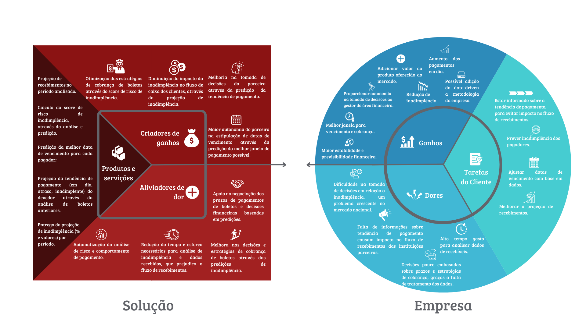
</div>
<br>
<div align="center">
<sub>Fonte: Material produzido pelo grupo The Seven, 2025.</sub>
</div>
<br>

&nbsp;&nbsp;&nbsp;&nbsp; Através da análise realizada pela equipe, identificamos que a solução deve entregar como:

#### Solução

**Produtos e Serviços**

&nbsp;&nbsp;&nbsp;&nbsp; A solução têm como objetivo criar uma POC (Prova de conceito) que utilize de um modelo de análise preditiva, que recebe os dados coletados pela empresa parceira de boletos anteriores (pagos ou não pagos), e calcule possíveis resultados para boletos futuros ou pendentes, tais como:

- **Calculo do score de risco de inadimplência, através da análise e predição**: Através da análise de boletos anteriores, a solução deve entregar qual o risco de inadimplência de um determinado pagador, a fim de identificar se o boleto será pago ou não.
- **Predição da melhor data de vencimento para cada pagador**: O sistema deve utilizar das datas de pagamentos e inclusão do boleto para calcular qual a melhor data de vencimento possível para determinado pagador.
- **Projeção da tendência de pagamento (em dia, em atraso, inadimplente) do devedor através da análise de boletos anteriores**: A solução deve calcular qual a tendência de pagamento do devedor através da análise dos boletos anteriores.
- **Entrega da projeção de inadimplência (porcentagem e valores) por período**: O sistema deve calcular o valor e porcentagem de inadimplência em um período.
- **Projeção de recebimentos no período analisado**: Calcular uma projeção do valor a ser recebido pelos clientes da Finnet em um determinado período.

**Aliviadores de Dores**

- **Automatização da análise de risco, comportamento de pagamento**: Automatizar a análise de risco de inadimplência e o comportamento de possíveis novos boletos, dados estes que eram calculados de forma manual, pouco eficaz ou não existiam.
- **Redução do tempo e esforço necessários para análise de inadimplência e dados recebidos**: Reduzir o tempo e esforço necessários pela empresa parceira para análise de inadimplência e dados recebidos, que prejudica o fluxo de recebimentos.
- **Melhora nas decisões e estratégias de cobrança**: Melhorar as decisões e estratégias de cobrança de boletos da empresa parceira através das predições de inadimplência.
- **Apoio na negociação de prazos e decisões financeiras baseadas em dados reais**: A plataforma deve prever novos prazos de vencimentos através na análise de dados anteriores, assim auxiliando na negociação dos prazos de pagamentos de boletos e decisões financeiras de recebimento da empresa.

**Criadores de Ganhos**

- **Melhora nas datas de vencimento**: O cálculo de prazos de vencimento gera autonomia para o parceiro na estipulação de novas datas de vencimento possíves, assim prevendo a melhor janela de pagamento possível.
- **Maior autonomia e assertividade do time financeiro na tomada de decisões**: Melhoria na tomada de decisões do parceira através da predição da tendência de pagamento do cliente (em dia, com atraso ou inadimplente).
- **Otimização das estratégias de cobrança de boletos**: A predição do score de risco de inadimplêmcia gera otimização das estratégias de cobrança de boletos, o que gera ganhos reais ao parceiro.
- **Menor impacto no fluxo de caixa do cliente**: Através do cálculo de projeções de recebimentos, há a diminuição do impacto da inadimplência no fluxo de caixa dos clientes, o que gera ganhos para os parceiros da Finnet.

#### Empresa

**Dores**

- **Dificuldade na tomada de decisões em relação a inadimplência**: Uma das maiores dores da Finnet é a dificuldade na tomada de decisões, uma vez que os dados não possuem uma análise e tratamento adequado para transformá-los em possíveis ganhos para a empresa. Além disso, a falta de embasamento para tomada de decisões é um problema crescente no mercado nacional.
- **Falta de informações sobre tendência de pagamento**: A falta de informações sobre a tendência de pagamentos é um problema recorrente na Finnet que causa impacto no fluxo de recebimentos das instituições parceiras, já que não há previsibilidade se o devedor realmente irá pagar o boleto ou não.
- **Decisões pouco embasadas sobre prazos e estratégias de cobrança**: A falta de automatização na análise dos prazos de pagamentos passados dos clientes causam decisões pouco embasadas e dificuldades nas estratégias para cálculo do melhor prazo de vencimento possível para cada vendedor.

- **Alto tempo gasto para analisar dados de recebíveis**: Os dados recebidos atualmente levam um grande tempo gasto para serem análisados de forma manual, além de trazer pouca precisão e confiabilidade nos resultados.

**Ganhos**

- **Maior estabilidade e previsibilidade financeira**: A projeção de recibimentos e predição da inadimplência geram maior estabilidade financeira tanto para a Finnet, quanto para seus clientes, já que melhora o fluxo de caixa e recebimento.
- **Melhor janela para vencimento e cobrança**: A predição da melhor data de vencimento e cobrança gera beneficios como o aumento da taxa de pagamento em dia, redução da inadimplência, otimização do fluxo de caixa e melhoria no relacionamento com o cliente.
- **Redução de inadimplência**: A análise preditiva e o ajuste de estratégias de cobrança permitem identificar riscos antecipadamente e manter a saúde financeira tanto da empresa, quanto de seus parceiros.
- **Proporcionar autonomia na tomada de decisões ao gestor da área financeira**: O acesso a projeções e estatísticas confiáveis permite que o gestor tome decisões estratégicas com mais segurança, agilidade e independência, reduzindo a dependência de processos manuais.
- **Adicionar valor ao produto oferecido ao mercado**: A incorporação de análises preditivas e inteligência financeira ao produto aumenta sua atratividade, diferenciação competitiva e percepção de qualidade, fortalecendo o posicionamento da marca e potencializando oportunidades de novas assinaturas de seu serviço.
- **Aumento dos pagamentos em dia**: O uso de modelos preditivos contribui para aumentar a realização dos pagamentos, por meio da identificação da data de vencimento mais adequada para cada cliente.

**Tarefas do Cliente**

- **Melhorar a projeção de recebimentos**: Uma das tarefas da Finnet com seus clientes é melhorar a projeção de recebimentos.
- **Ajustar datas de vencimento com base em dados**: Ajustar as datas de vencimento através com análise de pagamentos anteriores aumenta a atratividade da empresa e pode gerar novas assinaturas do seu serviço.
- **Prever inadimplência de clientes/pagadores**: A falta de previsões em relação a indimplência dos pagadores é um problema recorrente na empresa e implementação dessa tecnologia pode melhorar a relação da Finnet com seus clientes.
- **Estar informado sobre a tendência de pagamento**: Atualmente, a Finnet não possui nenhuma previsão em relação a tendência de pagamento do devedor, o que causa impacto no fluxo de recebimentos.

&nbsp;&nbsp;&nbsp;&nbsp; A criação do Canva Proposta de Valor permitiu alinhar de forma clara e estratégica as funcionalidades da solução às necessidades reais da Finnet e de seus clientes. A análise aprofundada das dores, ganhos e tarefas do cliente evidenciou que a aplicação de inteligência preditiva na análise de boletos não apenas automatiza processos antes manuais e imprecisos, mas também amplia a assertividade das decisões financeiras, otimiza o fluxo de caixa e fortalece o posicionamento competitivo da empresa. Dessa forma, a proposta apresentada vai além de resolver problemas imediatos, consolidando-se como um diferencial estratégico capaz de gerar valor contínuo, reduzir riscos e potencializar oportunidades de crescimento para a Finnet e seus parceiros.

A modelo do Canva Proposta de Valor está disponível em: https://www.canva.com/design/DAGvOr-iSA0/j7zPQIjIGNRC4wTqqMU_pw/edit?utm_content=DAGvOr-iSA0&utm_campaign=designshare&utm_medium=link2&utm_source=sharebutton

#### 4.1.5. Matriz de Riscos

&nbsp;&nbsp;&nbsp;&nbsp; A matriz de risco é uma ferramenta visual utilizada para identificar, classificar e priorizar riscos ou oportunidades com base na probabilidade de ocorrência e no impacto que podem causar no projeto ou na organização. Ela permite que as equipes tomem decisões mais assertivas, direcionando esforços para lidar primeiro com os pontos mais críticos.
No caso do nosso projeto, a matriz foi aplicada para mapear oportunidades relacionadas à previsão de inadimplência e à melhoria da gestão de recebíveis da Finnet. Os riscos e oportunidades foram posicionados nos quadrantes de acordo com sua probabilidade (Alta, Média ou Baixa) e impacto (Alto, Médio ou Baixo).
Uma das oportunidades identificadas como Alta probabilidade / Alto impacto foi a melhoria na previsão de inadimplência para reduzir perdas, já que isso afeta diretamente a eficiência na cobrança e os resultados financeiros.

<div align="center">
<sub>Figura 3: Matriz de Risco.</sub>
</div>
<br>
<div align="center">

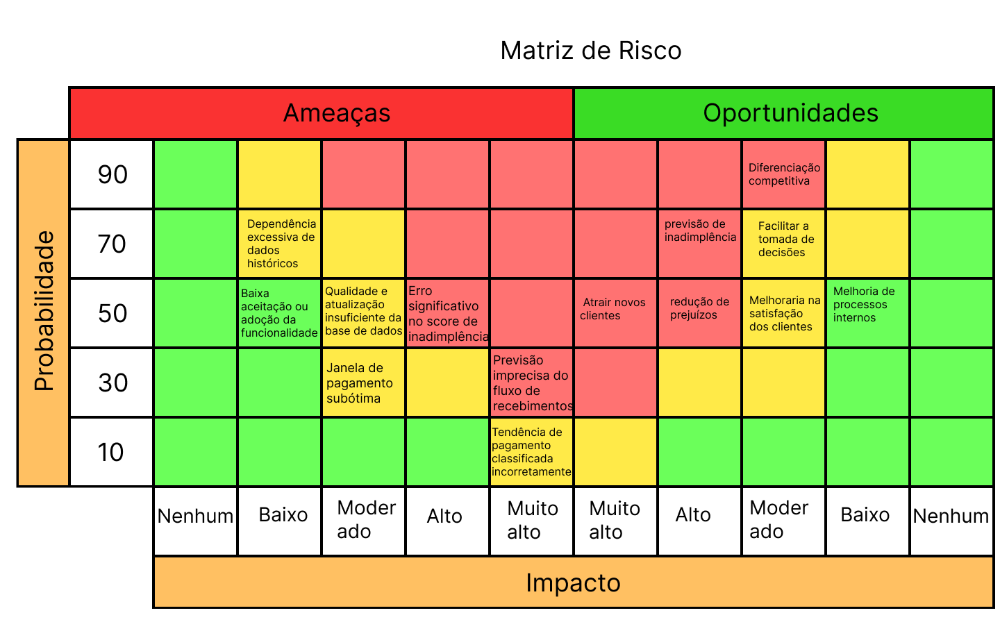
</div>

<div align="center">
<sub>Fonte: Material produzido pelo grupo The Seven, 2025.</sub>
</div>
<br>

&nbsp;&nbsp;&nbsp;&nbsp; A implementação da matriz de risco no projeto desempenhou um papel fundamental ao possibilitar a priorização das ações consideradas mais relevantes para o alcance dos objetivos propostos. Além disso, o uso dessa ferramenta se mostrou eficaz para promover um alinhamento claro dentro da equipe, facilitando a identificação das oportunidades que demandam ações mais urgentes, bem como dos possíveis riscos que exigem monitoramento contínuo e estratégias adequadas de mitigação.

##### Ameaças

1. **Previsão imprecisa do fluxo de recebimentos**:

&nbsp;&nbsp;&nbsp;&nbsp; A projeção incorreta do fluxo de caixa pode comprometer diretamente a saúde financeira dos clientes da Finnet, afetando decisões como pagamentos de fornecedores, funcionários, dívidas e investimentos. Uma previsão mal calibrada pode levar a déficits operacionais ou má alocação de recursos.

2. **Erro significativo no score de inadimplência**:

&nbsp;&nbsp;&nbsp;&nbsp; O score de risco de inadimplência orienta decisões cruciais, como concessão de crédito ou prazos de pagamento. Altas taxas de erro neste indicador podem gerar perdas financeiras relevantes, sobretudo em setores onde o risco de crédito é fator-chave, como instituições financeiras, empresas de cobrança e consórcios.

3. **Janela de pagamento subótima**

&nbsp;&nbsp;&nbsp;&nbsp; Indicar uma janela de pagamento que não considera o comportamento real ou a rotina financeira do devedor (como a data de recebimento de salário) pode reduzir as chances de recebimento, comprometendo a eficácia da cobrança.

4. **Tendência de pagamento classificada incorretamente**

&nbsp;&nbsp;&nbsp;&nbsp; Uma categorização equivocada do pagador como “em dia”, “com atraso” ou “inadimplente” pode distorcer o perfil de risco atribuído, gerando decisões inadequadas de cobrança ou concessão de crédito.

5. **Dependência excessiva de dados históricos**

&nbsp;&nbsp;&nbsp;&nbsp; Modelos preditivos baseados unicamente em dados históricos podem falhar diante de mudanças no contexto econômico, comportamental ou regulatório. Essa limitação afeta a capacidade de adaptação do sistema a novos padrões de comportamento dos pagadores.

6. **Baixa aceitação ou adoção da funcionalidade**

&nbsp;&nbsp;&nbsp;&nbsp; Mesmo que os modelos estejam tecnicamente corretos, a falta de transparência, explicabilidade ou integração com os fluxos do cliente pode gerar desconfiança e baixa adoção. Isso limita o valor percebido da funcionalidade e reduz o impacto do projeto.

7. **Qualidade e atualização insuficiente da base de dados**:

&nbsp;&nbsp;&nbsp;&nbsp; Informações desatualizadas, incompletas ou fora da distribuição esperada comprometem a qualidade das análises geradas. A confiabilidade dos insights depende diretamente da integridade e frescor dos dados utilizados.

##### Oportunidades

1. **Melhorar a previsão de inadimplência para reduzir perdas**

&nbsp;&nbsp;&nbsp;&nbsp; É o objetivo central da POC. Com bons dados, a previsão de inadimplência evita perdas financeiras diretas para os clientes, agregando valor imediato à solução.

2. **Aumentar a eficiência na cobrança (agindo no momento certo)**

&nbsp;&nbsp;&nbsp;&nbsp; Com uma boa previsão, é possível antecipar ações de cobrança no momento ideal, o que aumenta a taxa de sucesso no recebimento.

3. **Facilitar a tomada de decisão dos gestores financeiros**

&nbsp;&nbsp;&nbsp;&nbsp; Um dashboard simples com insights preditivos já melhora significativamente a rotina e o desempenho dos gestores financeiros.

4. **Melhorar a satisfação dos clientes por oferecer informações mais úteis**

&nbsp;&nbsp;&nbsp;&nbsp; Entregar dados preditivos relevantes aumenta o valor percebido da solução e contribui para uma melhor experiência de uso.

5. **Melhoria de processos internos**

&nbsp;&nbsp;&nbsp;&nbsp; A própria Finnet pode aplicar os resultados da POC para otimizar seus produtos e processos. A aplicação é simples, mas o impacto é mais localizado.

6. **Diferenciação competitiva no mercado de gestão de recebíveis**

&nbsp;&nbsp;&nbsp;&nbsp; Caso a solução final seja bem posicionada e entregue resultados sólidos, a Finnet pode se destacar no mercado por oferecer recursos preditivos avançados.

7. **Atrair novos clientes interessados em ferramentas preditivas**

&nbsp;&nbsp;&nbsp;&nbsp; Ao oferecer uma solução robusta e inovadora, há um grande potencial para criar novas oportunidades de negócios, principalmente junto a empresas que priorizam a utilização estratégica de inteligência de dados.

#### 4.1.6. Personas

&nbsp;&nbsp;&nbsp;&nbsp;O uso de personas em projetos de desenvolvimento é uma prática consolidada que permite compreender perfis de usuários e stakeholders, alinhando expectativas e reduzindo ambiguidades. Construídas a partir de dados reais, elas traduzem necessidades e comportamentos em representações acessíveis que orientam decisões estratégicas e de design. Neste trabalho, focado na criação de um modelo preditivo para mitigação da inadimplência de pessoas físicas, jurídicas e empresas, as personas assumem papel central ao aproximar a solução de realidades cotidianas, unindo análise quantitativa e qualitativa. Dessa forma, fortalecem o projeto ao integrar fundamentos técnicos e dimensões humanas, resultando em um modelo mais contextualizado, eficaz e alinhado ao mercado.

##### Pessoa Jurídica

<div align="center">
<sub align="center">Figura 4 – Persona - Pessoa Jurídica</sub>
</div>
<br>


<div align="center">

</div>
<br>


<div align="center">
<sup>Fonte: Produzido pelo grupo The Seven, 2025.</sup>
</div>
<br>

&nbsp;&nbsp;&nbsp;&nbsp; Carlos Almeida representa o perfil do decisor financeiro que busca soluções tecnológicas para otimizar a gestão de crédito e reduzir riscos de inadimplência. Como Chief Financial Officer de uma empresa de grande porte, lida diariamente com o desafio de manter a saúde financeira da organização, equilibrando previsibilidade de caixa, controle de recebimentos e mitigação de perdas. Sua atuação exige acesso rápido a informações confiáveis e ferramentas que apoiem decisões estratégicas baseadas em dados.

&nbsp;&nbsp;&nbsp;&nbsp; Sua finalidade como persona do projeto é representar as empresas impactadas diretamente pela solução, servindo como usuário estratégico que se beneficia do acesso a métricas avançadas, como o score de inadimplência. Com esses recursos, suas decisões financeiras ganham mais embasamento, fortalecendo a gestão de riscos e a previsibilidade de resultados.


#### Gerente Finnet

<div align="center">
<sub align="center">Figura 5 – Persona - Gerente Finnet</sub>
</div>
<br>


<div align="center">

</div>
<br>

<div align="center">
<sup>Fonte: Produzido pelo grupo The Seven, 2025.</sup>
</div>
<br>

&nbsp;&nbsp;&nbsp;&nbsp; Rogério Silveira é o perfil de cliente principal do projeto e atua como Gerente Financeiro na Finnet. Ele é responsável por monitorar transações e elaborar relatórios financeiros para empresas parceiras, garantindo que estas tenham uma visão clara e atualizada do seu fluxo de caixa. Com alta afinidade com tecnologia, busca automatizar processos de coleta e análise de dados, reduzindo o trabalho manual e aumentando a precisão das informações. Entre suas principais necessidades está prever a inadimplência e identificar tendências de pagamento, permitindo agir de forma proativa. Atualmente, Rogério deseja agregar valor ao serviço prestado pela Finnet implementando recursos como score de risco de inadimplência, melhor janela provável de pagamento e análise do impacto da inadimplência no fluxo de recebimentos, fortalecendo a tomada de decisão dos clientes e da própria empresa.

&nbsp;&nbsp;&nbsp;&nbsp; Essa persona representa os gestores financeiros da Finnet, público-alvo direto do projeto. Por sua função dentro da empresa, Rogério é o responsável por analisar os dados gerados e transformá-los em insights que agregam valor ao serviço oferecido aos clientes, fortalecendo tanto a tomada de decisão quanto a competitividade da organização.

#### Pessoa Física Inadimplente

<div align="center">
<sub align="center">Figura 4 – Persona - Pessoa Física Inadimplente</sub>
</div>
<br>

<div align="center">

</div>
<br>

<div align="center">
<sup>Fonte: Produzido pelo grupo The Seven, 2025.</sup>
</div>
<br>

&nbsp;&nbsp;&nbsp;&nbsp; Renata Arantes representa o perfil de uma pessoa física em situação de inadimplência, que enfrenta dificuldades financeiras para manter seus compromissos em dia. Seu comportamento reflete a realidade de muitos pagadores que, diante de imprevistos ou limitações de renda, acabam atrasando ou deixando de quitar boletos. Essa condição impacta diretamente tanto as empresas credoras quanto os intermediários financeiros que buscam reduzir riscos e manter previsibilidade em seus recebimentos.

&nbsp;&nbsp;&nbsp;&nbsp; Sua finalidade como persona do projeto é simbolizar os devedores cujos padrões de pagamento alimentam o modelo preditivo de inadimplência baseado em machine learning. Esta representa como perfis semelhantes influenciam a modelagem e a análise estatística. Nesse contexto, Renata funciona como um canvas que traz insights ao sistema em situações cotidianas, auxiliando na criação de estratégias mais assertivas de cobrança e mitigação de riscos com as features desenvolvidas no projeto.
 
#### Técnico de Informática 


<div align="center">
<sub align="center">Figura 4 – Persona - Técnico de informática</sub>
</div>
<br>

<div align="center">

</div>
<br>

<div align="center">
<sup>Fonte: Produzido pelo grupo The Seven, 2025.</sup>
</div>
<br>

&nbsp;&nbsp;&nbsp;&nbsp; Rafael Costa representa o perfil do analista técnico que busca soluções eficientes para garantir a estabilidade e a segurança dos sistemas corporativos. Atuando como Analista de Sistemas na Finnet, ele é responsável por desenvolver e manter plataformas financeiras, assegurando que atendam às exigências de confiabilidade e compliance. Seu dia a dia envolve lidar com alta demanda de suporte, integrações complexas e desafios relacionados à segurança da informação. Com forte afinidade tecnológica, Rafael procura ferramentas que otimizem processos, reduzam retrabalho e aumentem a agilidade na entrega de soluções, permitindo que a empresa continue oferecendo valor e inovação aos seus clientes. 

&nbsp;&nbsp;&nbsp;&nbsp; Para o projeto, Rafael representa os profissionais responsáveis pela implementação e manutenção técnica da solução dentro da plataforma já utilizada pela Finnet. Sua presença como persona garante a perspectiva de quem lida diretamente com integrações complexas e desafios de segurança, aspectos fundamentais para que o sistema funcione de forma estável, prática e eficiente. Assim, Rafael simboliza a ponte entre a viabilidade técnica e a entrega de valor ao usuário final.


</br></br>Em síntese, as personas apresentadas funcionam como representações estratégicas dos diferentes atores envolvidos no ecossistema de cobrança e gestão financeira. Cada uma delas traduz, de forma humanizada, as necessidades, dores e expectativas que o projeto busca atender. Ao integrar o modelo de predição de inadimplência com machine learning, essas personas atuam como pontos de referência que não só exemplificam o potencial impacto da solução, mas também a segurança de que o desenvolvimento técnico esteja constantemente alinhado à experiência prática dos usuários. Dessa forma, podemos reforçar a relevância e a utilidade da proposta tanto para a própria Finnet, quanto para instituições de finanças e seus respectivos atores em atividade.

#### 4.1.7. Jornadas do Usuário

&nbsp;&nbsp;&nbsp;&nbsp; A utilização de journey maps em nosso projeto foi fundamental para compreender de forma clara e organizada a experiência do usuário, especialmente no que diz respeito ao eixo de UX. Essa ferramenta possibilitou representar visualmente cada etapa percorrida pelo usuário, facilitando a identificação de pontos de contato relevantes e de possíveis dificuldades ao longo do processo. Com isso, conseguimos projetar de maneira mais precisa como o usuário final interagirá com o modelo preditivo desenvolvido em Python, garantindo que a solução seja não apenas tecnicamente eficaz, mas também alinhada às expectativas e necessidades reais de quem irá utilizá-la.

&nbsp;&nbsp;&nbsp;&nbsp; A figura a seguir apresenta os sinais identificados nas jornadas de usuário. As etapas marcadas com seta para cima indicam pontos com maior número de oportunidades, enquanto as etapas com seta para baixo evidenciam aquelas em que prevalecem os problemas.

<br>
<div align="center">
<sub align="center">Figura 6 – Descrição de Oportunidades e Problemas</sub>
</div>
<br>
<div align="center">

</div>
<br>
<div align="center">
<sup>Fonte: Produzido pelo grupo The Seven, 2025.</sup>
</div>
<br>
<div align="center">
<sub align="center">Figura 7 – Jornada de Usuário - Pessoa Jurídica</sub>
</div>
<br>
<div align="center">

</div>
<br>
<div align="center">
<sup>Fonte: Produzido pelo grupo The Seven, 2025.</sup>
</div>
<br>

&nbsp;&nbsp;&nbsp;&nbsp; A persona escolhida, Carlos Almeida, representa uma pessoa jurídica e reflete os desafios complexos enfrentados por gestores financeiros de empresas, como a dificuldade em gerenciar grandes volumes de recebimentos, mitigar riscos de inadimplência e garantir previsibilidade no fluxo de caixa. Optamos por esse perfil porque ele evidencia problemas organizacionais e estratégicos que não se limitam ao indivíduo, mas impactam diretamente a sustentabilidade do negócio. Dessa forma, o journey map permite mapear desde a frustração inicial até a satisfação com soluções de análise preditiva, dashboards e estratégias personalizadas de cobrança, demonstrando o valor de ferramentas que oferecem clareza, confiabilidade e suporte à tomada de decisão no contexto corporativo.

<br>
<div align="center">
<sub align="center">Figura 8 – Jornada de Usuário - Pessoa Finnet</sub>
</div>
<br>
<div align="center">

</div>
<br>
<div align="center">
<sup>Fonte: Produzido pelo grupo The Seven, 2025.</sup>
</div>
<br>

&nbsp;&nbsp;&nbsp;&nbsp; Escolhemos o Rogério como persona do journey map porque ele representa um ator crítico dentro da Finnet: o gerente financeiro responsável por consolidar relatórios e entregar previsões confiáveis à diretoria e às empresas clientes. A ausência de análises preditivas detalhadas hoje compromete sua confiabilidade e reduz a segurança do planejamento financeiro. Ao mapear sua jornada, evidenciamos gargalos como processos manuais, dispersão de dados e ciclos de fechamento demorados, e identificamos oportunidades de evolução com automação, integração de fontes, modelagem preditiva e relatórios em tempo real. Assim, o journey map orienta a priorização de soluções que elevem a acurácia das previsões, reduzam retrabalho e fortaleçam o papel da Finnet como parceira confiável na gestão financeira dos clientes.

&nbsp;&nbsp;&nbsp;&nbsp; Em síntese, o uso de journey maps se mostrou fundamental para garantir que o desenvolvimento do modelo preditivo em Python fosse orientado não apenas pela lógica técnica, mas também pela perspectiva do usuário. Ao possibilitar a visualização detalhada da jornada, essa ferramenta contribuiu para antecipar potenciais barreiras, refinar pontos de interação e alinhar a solução às reais necessidades dos futuros usuários. Assim, asseguramos que o projeto alcance maior usabilidade, relevância prática e impacto efetivo no contexto em que será aplicado.

#### 4.1.8 Política de Privacidade

##### Modelo de Política de Privacidade:

Projeto [NOME DO PROJETO]

##### Informações Gerais

&nbsp;&nbsp;&nbsp;&nbsp; Esta política de privacidade informa como o projeto **[NOME DO PROJETO]**, desenvolvido pelo grupo The Seven, trata os dados pessoais coletados durante o uso da solução. Está em conformidade com a Lei nº 13.709/2018 – LGPD.

##### Dados Coletados

A Finnet forneceu os seguintes dados pessoais:

- Id do grupo.
- Id do beneficiário.
- Data de inclusão do pagamento.
- Status do boleto
- Data de vencimento da fatura
- Valor a ser pago pelo beneficiário
- Data de pagamento
- Nome do banco emissor
- Id do pagador
- CEP do pagador.

Não foram fornecidos dados sensíveis sobre os titulares.

##### Dados coletados automaticamente:

- Quantidade de acessos do pagador
- Última data de acesso.

##### Finalidade do Tratamento

&nbsp;&nbsp;&nbsp;&nbsp; Os dados pessoais coletados serão tratados com as seguintes finalidades:

- Garantia do funcionamento da plataforma, permitindo a análise do comportamento de pagamento e a geração de insights preditivos sobre inadimplência;
- Elaboração de estatísticas e projeções, tais como, score de risco de inadimplência, tendência de pagamento (em dia, com
  atraso, inadimplente) e previsão de recebimentos, para apoiar a tomada de decisões da área financeira da empresa parceira.

&nbsp;&nbsp;&nbsp;&nbsp; A utilização desses dados é permitida de acordo com o artigo 7 da LGPD:

- I - mediante o fornecimento de consentimento pelo titular (cliente do parceiro);
- II - para o cumprimento de obrigação legal ou regulatória pelo controlador;
- V - quando necessário para a execução de contrato ou de procedimentos preliminares relacionados a contrato do qual seja parte o titular, a pedido do titular dos dados;
- IX - quando necessário para atender aos interesses legítimos do controlador ou de terceiro, exceto no caso de prevalecerem direitos e liberdades fundamentais do titular que exijam a proteção dos dados pessoais.

&nbsp;&nbsp;&nbsp;&nbsp; Além disso, os dados fornecidos não são identificados como sensíveis ou referentes a menores de idade, portanto, não infringem, de qualquer forma, o artigo 11 da Lei Geral de Proteção de Dados Nº 13.709.

##### Armazenamento e Retenção

&nbsp;&nbsp;&nbsp;&nbsp; Os dados utilizados no projeto serão armazenados em um documento no Drive e repositório no Github para facilitar seu uso.

##### Prazo

&nbsp;&nbsp;&nbsp;&nbsp; O acesso aos dados fornecidos é válido por dois meses e meio, tempo referente a duração do projeto.

##### Compartilhamento de Dados

&nbsp;&nbsp;&nbsp;&nbsp; Os dados e resultados gerados a partir da solução podem ser compartilhados somente com a empresa parceira do projeto.

##### Segurança dos Dados

&nbsp;&nbsp;&nbsp;&nbsp; Para garantir a segurança dos dados, é realizado o controle do acesso, de modo que apenas os envolvidos no projeto têm acesso pleno a eles.

##### Direitos dos Titulares

&nbsp;&nbsp;&nbsp;&nbsp; Os titulares dos dados podem solicitar:

- Acesso aos seus dados;
- Correção de informações incorretas;
- Exclusão de dados;
- Portabilidade de dados;
- Oposição ao tratamento e revogação de consentimento.

&nbsp;&nbsp;&nbsp;&nbsp; Para exercer esses direitos, envie uma solicitação para: govcorp@finnet.com.br.

##### Encarregado de Dados (DPO)

**Nome:** Marília Nascimbeni Buchala <Br>
**E-mail:** mbuchala@gmail.com

### 4.2. Compreensão dos Dados

&nbsp;&nbsp;&nbsp;&nbsp; A compreensão dos dados é uma etapa fundamental no processo de análise, pois permite identificar padrões, relações e possíveis inconsistências presentes no conjunto analisado. Nesta fase, busca-se explorar as variáveis disponíveis, avaliando suas distribuições, correlações e significados dentro do contexto do problema. Essa etapa fornece uma visão geral do comportamento dos dados, permitindo levantar hipóteses iniciais e orientar as etapas seguintes de pré-processamento e modelagem.

#### 4.2.1. Exploração de dados

&nbsp;&nbsp;&nbsp;&nbsp; Nesta etapa, foi realizada uma análise exploratória detalhada dos dados, com o objetivo de compreender as principais características das variáveis e suas relações. O processo seguiu as seguintes etapas:

**1. Estatística descritiva básica de cada coluna**

Foram aplicadas funções como `describe()` e análise de frequência para todas as colunas dos dataframes, permitindo identificar:
- Distribuição de valores (média, mediana, desvio padrão, quartis) para variáveis numéricas como `vl_boleto`, `vl_pagto`, `juros`, `qtd_acessos_pagador`.
- Frequência e proporção das categorias para variáveis categóricas como `status_boleto`, `banco`, `pagador_cidade`.
- Análise de datas (`data_inclusao`, `data_vencto`, `dt_pagto`) para entender sazonalidade e intervalos de pagamento.

**2. Identificação dos tipos de colunas**

As colunas foram classificadas conforme abaixo:
- **Numéricas:** `vl_boleto`, `vl_pagto`, `juros`, `qtd_acessos_pagador`, `dias_para_pagar`, `dias_para_vencer`.
- **Categóricas:** `status_boleto`, `banco`, `pagador_cidade`, `tipo_juros`.
- **Datas:** `data_inclusao`, `data_vencto`, `dt_pagto` (convertidas para datetime e desmembradas em ano, mês, dia para análises específicas).

**3. Visualizações gráficas**

Foram gerados diversos gráficos para explorar as relações entre as variáveis. Destacam-se:

- **Gráfico 1: Pagamentos vs Boletos Incluídos por Mês**
  - Barras para o número de boletos incluídos e pagos em cada mês. Permitiu identificar sazonalidade e meses críticos para inadimplência.
<br>
<div align="center">
<sub align="center">Figura 9 – Gráfico de relação entre número de boletos incluídos de pagos por mês.</sub>
</div>
<br>
<div align="center">
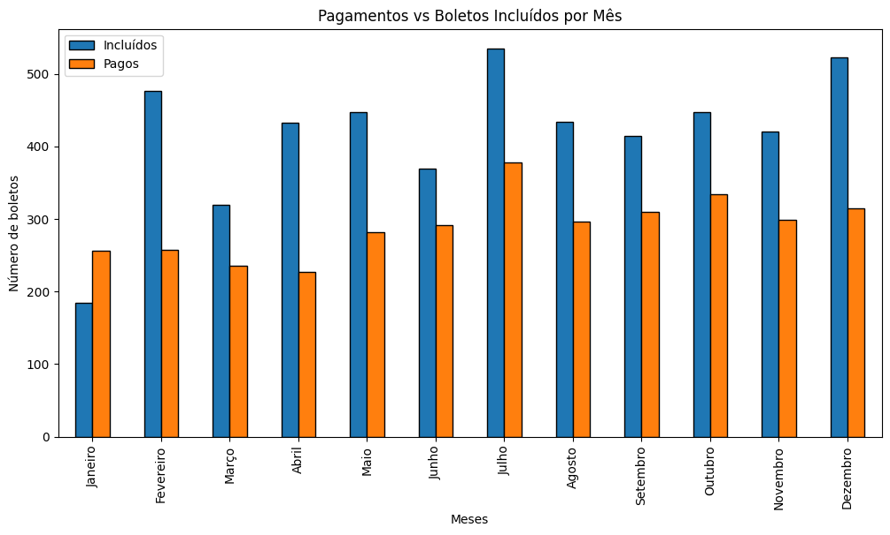
</div>
<br>
<div align="center">
<sup>Fonte: Produzido pelo grupo The Seven, 2025.</sup>
</div>
<br>

- **Gráfico 2: Quantidade de acessos por status de número de boletos pagos**
  - Barplot comparando a média de acessos à plataforma entre boletos pagos e não pagos. Evidenciou que usuários que pagam tendem a acessar mais a plataforma.
<br>
<div align="center">
<sub align="center">Figura 10 – Quantidade de acessos por status de número de boletos pagos.</sub>
</div>
<br>
<div align="center">
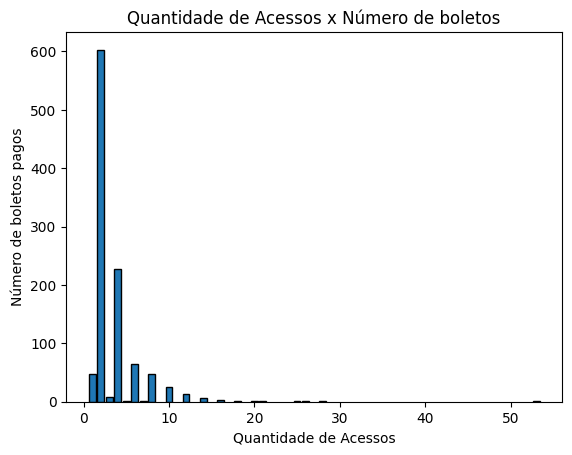
</div>
<br>
<div align="center">
<sup>Fonte: Produzido pelo grupo The Seven, 2025.</sup>
</div>
<br>

- **Gráfico 3: Quantidade de boletos por dias possíveis para pagar**
  - Histograma mostrando a relação entre a quantidade de boletos por dias possíveis de pagamento (Diferença entre data de inclusão e vencimento)

<br>
<div align="center">
<sub align="center">Figura 11 – Quantidade de acessos por status de número de boletos pagos.</sub>
</div>
<br>
<div align="center">
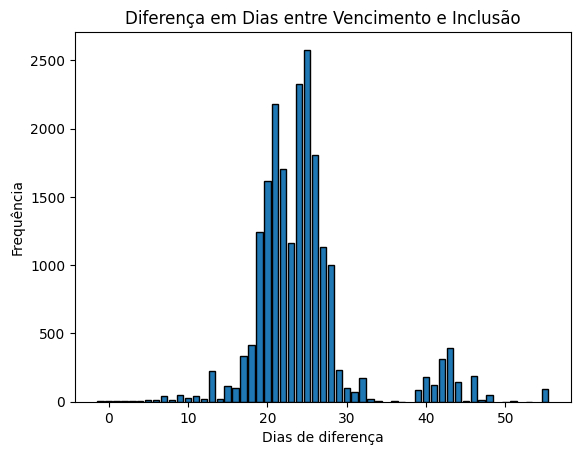
</div>
<br>
<div align="center">
<sup>Fonte: Produzido pelo grupo The Seven, 2025.</sup>
</div>
<br>

- **Gráfico 4: Pagamentos vs Boletos Incluídos por Mês (Com taxa de pagamento)**
  - Barras para o número de boletos incluídos e pagos em cada mês, com linha de taxa de pagamento (%). Permitiu identificar sazonalidade e meses críticos para inadimplência.
<br>
<div align="center">
<sub align="center">Figura 12 – Gráfico de número de boletos e meses do ano.</sub>
</div>
<br>
<div align="center">
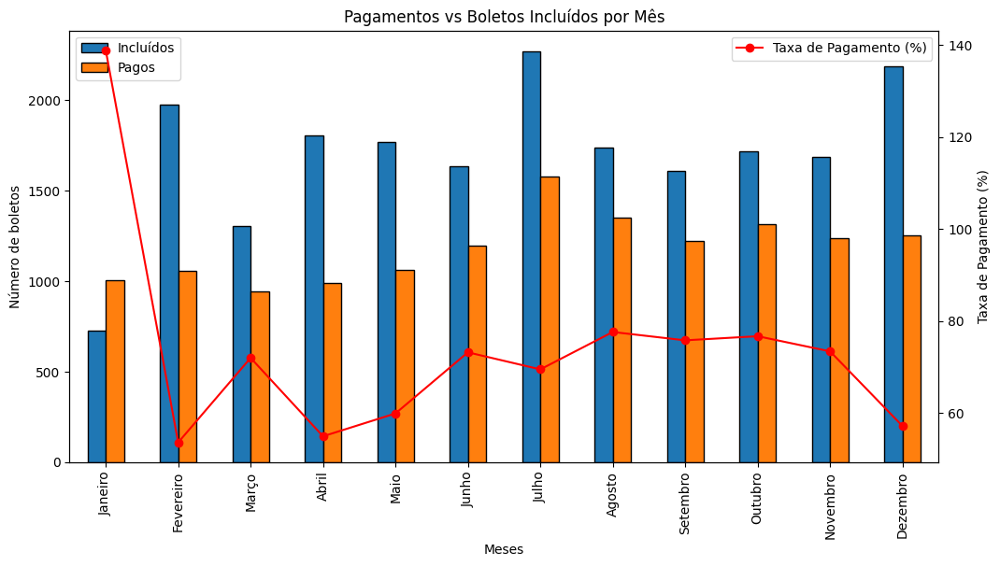
</div>
<br>
<div align="center">
<sup>Fonte: Produzido pelo grupo The Seven, 2025.</sup>
</div>
<br>

- **Gráfico 5: Média de acessos x Status do pagamento**
  - O gráfico a seguir busca mostrar a diferença de média de acessos a plataforma entre boletos pagos e não pagos.
<br>
<div align="center">
<sub align="center">Figura 13 – Gráfico de relação entre status do boleto e média de acessos na plataforma.</sub>
</div>
<br>
<div align="center">
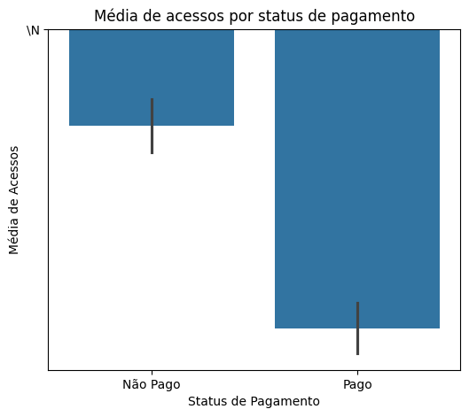
</div>
<br>
<div align="center">
<sup>Fonte: Produzido pelo grupo The Seven, 2025.</sup>
</div>
<br>

- **Gráfico 6: Dias para pagar x Valor do boleto**
  - O gráfico a seguir busca mostrar a relação entre o valor do boleto e os dias necessários para pagar.
<br>
<div align="center">
<sub align="center">Figura 14 – Gráfico de relação entre dias para pagar e valor do boleto.</sub>
</div>
<br>
<div align="center">
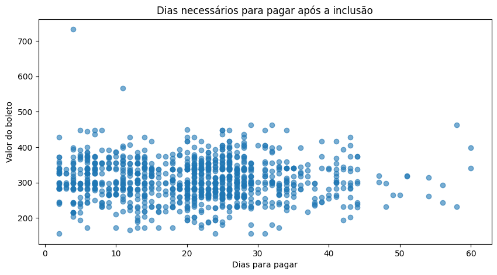
</div>
<br>
<div align="center">
<sup>Fonte: Produzido pelo grupo The Seven, 2025.</sup>
</div>
<br>

- **Gráfico 7: Status do pagamento x média de valor**
  - O gráfico Boxplot a seguir busca mostrar a relação entre a média de valor entre boletos pagos e não pagos.
<br>
<div align="center">
<sub align="center">Figura 15 – Gráfico de relação entre status do pagamento e média de valor do boleto.</sub>
</div>
<br>
<div align="center">
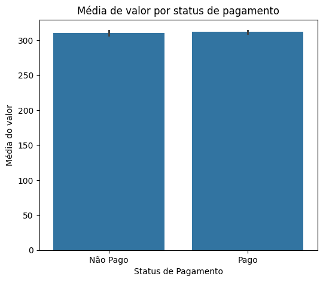
</div>
<br>
<div align="center">
<sup>Fonte: Produzido pelo grupo The Seven, 2025.</sup>
</div>
<br>


- **Gráfico 8: Cidade x média de valor**
  - O histograma a seguir demonstra as cidades com maior média de valor dentre uma amostra selecionada.
<br>
<div align="center">
<sub align="center">Figura 16 – Gráfico de relação entre cidade e média de valor.</sub>
</div>
<br>
<div align="center">
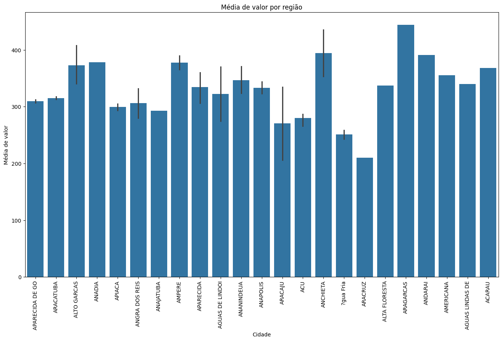
</div>
<br>
<div align="center">
<sup>Fonte: Produzido pelo grupo The Seven, 2025.</sup>
</div>
<br>

&nbsp;&nbsp;&nbsp;&nbsp; Essas análises permitiram identificar padrões importantes, como a influência do mês na taxa de pagamento, o impacto do engajamento do usuário (acessos) na adimplência e a distribuição dos valores dos boletos pagos e não pagos.


#### 4.2.2. Pré-processamento dos dados

&nbsp;&nbsp;&nbsp;&nbsp; O processo de análise de dados exige uma preparação cuidadosa para garantir que as informações estejam organizadas, limpas e adequadas para a modelagem. Para isso, foi realizada uma série de etapas de pré-processamento que envolveram desde a importação das bibliotecas necessárias até a transformação e normalização dos dados. Essas etapas visaram estruturar os registros de forma padronizada, corrigir inconsistências e reduzir impactos de valores ausentes ou extremos, assegurando maior confiabilidade na análise estatística e nas futuras aplicações em modelos preditivos.

&nbsp;&nbsp;&nbsp;&nbsp; A exploração e preparação dos dados foi realizada de forma estruturada, conforme documentado no notebook do projeto:


- **Conversão de Tipos:** As colunas foram classificadas em numéricas e categóricas, sendo convertidas para os tipos apropriados. Valores ausentes e entradas inválidas foram tratados, substituindo por NaN ou categorias específicas, como datatime e textos/objetos.

- **Tratamento de Valores Ausentes:** Colunas irrelevantes foram removidas (referentes principalmente às multas por estarem majoritariamente vazias) e valores ausentes em variáveis importantes, como valor de pagamento e cidade do pagador, foram preenchidos com valores padrão ou categorias “Desconhecido”.

- **Estatística Descritiva:** Foram geradas estatísticas descritivas para cada dataframe.

- **Tratamento de Outliers:** Outliers nas variáveis numéricas foram tratados utilizando a técnica de capping, limitando os valores aos intervalos interquartis.

- **Codificação de Variáveis Categóricas:** As variáveis categóricas foram transformadas em valores binários (one-hot encoding),tornando-as adequadas para uso em modelos preditivos.

- **Normalização:** As variáveis numéricas foram normalizadas utilizando o StandardScaler, padronizando a escala dos dados para melhorar o desempenho dos algoritmos de machine learning na escala de 0-10000 algarismos.


&nbsp;&nbsp;&nbsp;&nbsp; Esse fluxo garante que todas as etapas fundamentais de preparação dos dados foram seguidas, promovendo qualidade e robustez para o desenvolvimento do modelo preditivo.

&nbsp;&nbsp;&nbsp;&nbsp; Com a execução dessas etapas de pré-processamento, os dados foram devidamente estruturados, tratados e normalizados, eliminando inconsistências e preparando-os para análises mais aprofundadas. Esse trabalho garante uma base sólida e confiável, permitindo a construção de gráficos, extração de insights relevantes e melhor entendimento das relações e importância das variáveis do nosso conjunto para criação do nosso modelo preditivo.

&nbsp;&nbsp;&nbsp;&nbsp; Todas as etapas do Pré-Processamento e criação dos gráficos são encontradas no notebook geral do projeto, localizado em: <a href="../notebooks/Exploração_de_Dados,_Pré_processamento_e_Levantamento_de_Hipóteses_The_Seven.ipynb">**Link do Notebook**</a>

#### 4.2.3. Hipóteses

&nbsp;&nbsp;&nbsp;&nbsp; Nesta análise, foram levantadas hipóteses relacionadas ao comportamento de pagamento de boletos pelos usuários da plataforma. O objetivo é identificar padrões e fatores que influenciam o tempo de pagamento. Essas hipóteses servem como base para exploração de dados e para a criação do modelo preditivo, auxiliando na compreensão dos fatores que impactam atrasos, pontualidade nos pagamentos e permitem identificar quais variáveis impactão ou não no pagamento de boletos.


#### Hipotese 1

- **Hipótese 1:** A média de acesso de pessoas que pagaram o boleto é maior que as que não pagaram.

&nbsp;&nbsp;&nbsp;&nbsp; Essa hipótese busca confirmar que usuários que efetivam o pagamento de seus boletos tendem a apresentar uma quantidade de acessos à plataforma significativamente maior do que aqueles que não realizam o pagamento.

&nbsp;&nbsp;&nbsp;&nbsp; O número de acessos pode refletir o nível de engajamento do usuário com a plataforma. Um usuário mais engajado costuma ter maior contato com os serviços, maior percepção de valor e, consequentemente, maior probabilidade de honrar o pagamento. Por outro lado, usuários com baixa frequência de acessos podem demonstrar desinteresse ou menor vínculo, aumentando a chance de inadimplência.

&nbsp;&nbsp;&nbsp;&nbsp; Se a hipótese for confirmada, a quantidade de acesso pode se tornar uma forte variável na implementação do modelo preditivo, pois se torna um dos indicadores de pagamento e influencia na busca de inadimplentes.

&nbsp;&nbsp;&nbsp;&nbsp; No gráfico abaixo, o eixo X possui dois valores, os boletos pagos e não pagos, enquanto o eixo Y representa a média de acessos dos usuários de cada um desses grupos.

<br>
<div align="center">
<sub align="center">Figura 17 – Gráfico de relação entre status do boleto e média de acessos na plataforma.</sub>
</div>
<br>
<div align="center">

</div>
<br>
<div align="center">
<sup>Fonte: Produzido pelo grupo The Seven, 2025.</sup>
</div>
<br>

**Resultado:** Portanto, através da análise do gráfico, é possível confirmar que a média de acessos das pessoas que pagaram os boletos é consideravelmente maior que das pessoas que não pagaram.

#### Hipotese 2

- **Hipótese 2:** O período do ano influencia diretamente na taxa de pagamento de boletos.


&nbsp;&nbsp;&nbsp;&nbsp; Esta hipótese busca confirmar que a taxa de pagamento de boletos varia de acordo com o mês ou período do ano, influenciada por fatores sazonais e econômicos. Em determinados meses, como dezembro (festividades de fim de ano) ou março/abril (pagamento de impostos), pode haver uma maior pressão financeira, reduzindo a taxa de quitação de boletos. Já em períodos de maior liquidez, como meses de recebimento de 13º salário ou distribuição de bônus corporativos, a taxa de pagamento tende a aumentar. Além disso, mudanças na governança ou estratégias financeiras das empresas ao longo do ano podem impactar diretamente a capacidade de honrar pagamentos.

&nbsp;&nbsp;&nbsp;&nbsp; No gráfico abaixo, análisamos mais de 30 mil boletos entre um período de 12 meses, utilizando Python e bibliotecas como Pandas, Matplotlib e Seaborn. O eixo X representa os meses do ano, enquanto o Y representa o número de boletos. A barra em azul representa os boletos incluídos, a laranja os boletos pagos e a linha vermelha representa a taxa de pagamento em porcentagem.

<br>
<div align="center">
<sub align="center">Figura 18 – Gráfico de relação entre mês, número de boleto e taxa de pagamento.</sub>
</div>
<br>
<div align="center">

</div>
<br>
<div align="center">
<sup>Fonte: Produzido pelo grupo The Seven, 2025.</sup>
</div>
<br>

&nbsp;&nbsp;&nbsp;&nbsp; A análise do gráfico revela padrões importantes no comportamento de pagamento dos boletos. Em janeiro, observa-se que a quantidade de pagamentos supera a de inclusões, o que desmonstra o impacto das festividades e despesas concentradas no fim do ano. Isso ocorre porque em dezembro há um aumento expressivo na emissão de boletos, enquanto em janeiro, período de retomada das atividades, o número de novos boletos é significativamente menor.

&nbsp;&nbsp;&nbsp;&nbsp; Além disso, nota-se que em abril a taxa de pagamentos apresenta um dos menores índices do ano, o que pode estar associado à sobrecarga financeira causada pelo pagamento de impostos obrigatórios, como o Imposto de Renda e tributos anuais. Esse padrão reforça a influência de fatores econômicos e sazonais na dinâmica de pagamento.

**Resultado:** Portanto, é possível afirmar que o período do ano influncia diretamente no pagamento de boletos.

#### Hipotese 3

- **Hipótese 3:** Boletos com valores mais altos tendem a ser pagos em um maior número de dias após a emissão, enquanto boletos de menor valor costumam ser liquidados mais rapidamente.

&nbsp;&nbsp;&nbsp;&nbsp; Essa hipótese busca afirmar se valores elevados representam um maior impacto no orçamento do cliente, já que exigem maior planejamento financeiro, o que pode gerar atrasos ou maior tempo médio até o pagamento.

&nbsp;&nbsp;&nbsp;&nbsp; Esse comportamento pode estar associado tanto ao poder aquisitivo dos clientes quanto à priorização de despesas no ciclo financeiro. 

&nbsp;&nbsp;&nbsp;&nbsp; No gráfico abaixo, o eixo X representa os dias necessários para pagar o boleto e o Y o valor do boleto.

<br>
<div align="center">
<sub align="center">Figura 19 – Gráfico de relação entre valor do boleto e dias necessários para pagar.</sub>
</div>
<br>
<div align="center">

</div>
<br>
<div align="center">
<sup>Fonte: Produzido pelo grupo The Seven, 2025.</sup>
</div>
<br>

&nbsp;&nbsp;&nbsp;&nbsp; A partir da análise do gráfico acima, é possível identificar que não há uma tendência linear clara entre essas variáveis. A maioria dos pagamentos ocorre em até 30 dias, concentrando-se em boletos de R$ 200 a R$ 400. Casos isolados de valores acima de R$ 600 mostram pagamentos tanto rápidos quanto atrasados, sugerindo que o valor sozinho não determina o tempo de quitação. Após 40 dias, os pagamentos se tornam mais raros. Assim, o prazo para pagamento parece depender mais de fatores como comportamento do cliente, sazonalidade ou disciplina financeira, indicando que o valor do boleto deve ser analisado junto a outras variáveis em modelos preditivos.

**Resultado:** Portanto, é possível afirmar que NÃO há uma relação clara entre o valor do boleto e tempo necessário para pagar.

#### Hipotese 4

- **Hipótese 4:** O tempo necessário para pagamento de boletos varia de acordo com o perfil financeiro e comportamento dos clientes

&nbsp;&nbsp;&nbsp;&nbsp; Esta hipótese busca confirmar que o tempo necessário para pagamento de boletos varia de acordo com o perfil financeiro e comportamento dos clientes. Observa-se que grande parte dos boletos é quitada dentro dos primeiros 30 dias após a inclusão, indicando que muitos clientes priorizam pagamentos imediatos. Por outro lado, uma parcela menor apresenta atrasos mais longos, podendo estar relacionada a dificuldades financeiras temporárias, menor disciplina de pagamento ou atrasos na compensação bancária.

&nbsp;&nbsp;&nbsp;&nbsp; No gráfico abaixo, o eixo X representa os dias necessários para pagar, enquanto o eixo Y representa o número de boletos quitados em cada período. Cada ponto azul indica a quantidade de boletos pagos após determinado número de dias desde a inclusão.

<br>
<div align="center">
<sub align="center">Figura 20 – Gráfico de relação entre valor do boleto e dias necessários para pagar.</sub>
</div>

<div align="center">
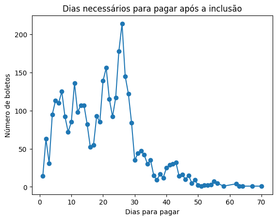
</div>

<div align="center">
<sup>Fonte: Produzido pelo grupo The Seven, 2025.</sup>
</div>
<br>

&nbsp;&nbsp;&nbsp;&nbsp; A análise do gráfico revela padrões importantes no comportamento de pagamento. Observa-se um pico significativo entre 20 e 30 dias, sugerindo que a maioria dos clientes paga dentro do prazo mensal típico. Além disso, o número de boletos pagos decresce rapidamente após 40 dias, evidenciando que atrasos prolongados são menos frequentes, mas ainda presentes, indicando a necessidade de monitoramento e estratégias de cobrança para evitar inadimplência.

**Resultado:** Portanto, é possível afirmar que o tempo de pagamento de boletos segue um padrão concentrado nos primeiros 30 dias, com uma diminuição acentuada à medida que os dias avançam.

#### Hipotese 5

- **Hipótese 5:** Média de valor entre boletos pagos e não pagos.

&nbsp;&nbsp;&nbsp;&nbsp; Esta hipótese busca afirmar que a média de valor é maior para os boletos com status 'Não Pago', sugerindo que valores mais altos podem influenciar negativamente a quitação dos boletos.

<br>
<div align="center">
<sub align="center">Figura 21 – Gráfico de relação entre status do pagamento e média de valor do boleto.</sub>
</div>
<br>
<div align="center">

</div>
<br>
<div align="center">
<sup>Fonte: Produzido pelo grupo The Seven, 2025.</sup>
</div>
<br>

**Resultado**: Após a análise do gráfico, pode-se concluir que a média de valor entre boletos pagos e não pagos é praticamente igual, o que anula completamente a hipótese de que a média de valor de boletos não pagos é maior.

&nbsp;&nbsp;&nbsp;&nbsp; As hipóteses levantadas permitem direcionar análises quantitativas para verificar a influência de diferentes fatores sobre o comportamento de pagamento. A avaliação de padrões relacionados a valores, frequência de acessos e histórico de pagamentos ajuda a confirmar ou rejeitar essas hipóteses, identificando variáveis relevantes para modelos preditivos e aprimorando a tomada de decisão baseada em dados.

### 4.3. Preparação dos Dados e Modelagem

&nbsp;&nbsp;&nbsp;&nbsp; Nessa seção, foram desenvolvidos os modelos preditivos necessários para atender às entregas propostas no TAPI, cada um deles com objetivos específicos:

- Modelo de score de risco de inadimplência: elaborado com base em técnicas de aprendizado supervisionado do tipo regressão, este modelo atribui uma pontuação de risco aos clientes, permitindo identificar a probabilidade de inadimplência e subsidiar estratégias de mitigação.

- Modelo de tendência de pagamento: estruturado como um problema de classificação e de aprendizado supervisionado, esse modelo prevê se o pagamento ocorrerá em dia, com atraso ou se resultará em inadimplência, fornecendo uma visão antecipada do comportamento do pagador.

- Modelo de impacto projetado no fluxo de recebimentos: criado para estimar como diferentes cenários de pagamento (adimplência, atraso ou inadimplência) afetam o fluxo de caixa futuro, permitindo ao grupo avaliar riscos financeiros e tomar decisões de planejamento. Esse modelo será estruturado como um problema de regressão e a aprendizagem será feita de forma supervisionada.

&nbsp;&nbsp;&nbsp;&nbsp; A partir desses modelos, torna-se possível entregar todas as demandas previstas no TAPI.

### 4.3.1 Tratamento de Dados

&nbsp;&nbsp;&nbsp;&nbsp; Durante o processo de criação de gráficos e hipóteses, alguns dos novos dados criados durante esse processo não foram previamente tratados e normalizados, dessa forma, realizamos novamente a substituição dos valores nulos, codificação das variáveis categóricas e substituição dos valores ausentes. 

&nbsp;&nbsp;&nbsp;&nbsp;Dessa forma, os seguintes tratamentos foram realizados:

- **Substituição dos valores ausentes:** Os valores que estavam ausentes, nesse caso preenchidos por NaN (Not a Number) das tabelas **dias_para_pagar**, **qtd_acessos_pagador_norm** e **pago/n** foram substituidos por 0, assim possibilitando a utilização dessas dados pelo modelo preditivo.

- **Transformação das novas features:** Se fez necessário transformar as novas features desenvolvidas nos gráficos, hipóteses e na preparação do modelo preditivo, para o formato "Label Encoder", transformando assim variáveis categóricas como (**mes_inclusão**, **mes_pag**, **pagador_inscricao_hash**, **pago/n (pago ou não)** e **mes_vencto**) em números que representam cada uma das categorias, para que assim, os dados possam ser entendidos pelo modelo.

- **Normalização dos dados:** Durante a criação do modelo preditivo, notamos que a alta dispersão de valores dos dados interfere diretamente na acurácia e resultados do modelo. Portanto, fez-se necessário criar uma escala padrão para as colunas, transformando assim as linhas de algumas colunas em números em uma escala de (0,1) para melhor aproximação dos dados e assim garantindo melhores resultados e acurácia nos modelos criados.

&nbsp;&nbsp;&nbsp;&nbsp; Após a etapa de tratamento e preparação dos dados, todas as colunas que serão utilizadas pelos modelos preditivos passaram por um processo de padronização, limpeza e ajuste, de forma a garantir que estejam devidamente adequadas para os cálculos e análises subsequentes. Esse cuidado é fundamental para assegurar que os modelos possam operar com dados consistentes, sem ruídos ou valores inválidos, o que contribui não apenas para evitar a ocorrência de erros durante a execução, mas também para aumentar a confiabilidade dos resultados obtidos. Dessa maneira, cria-se uma base sólida para que as previsões geradas apresentem maior precisão, desempenho otimizado e relevância prática para a tomada de decisão. 


#### 4.3.2 Modelo de Tendência de Pagamentos

&nbsp;&nbsp;&nbsp;&nbsp; O modelo preditivo de tendência de pagamentos tem como objetivo identificar a probabilidade de o devedor realizar o próximo pagamento em dia, com atraso ou em inadimplência. Trata-se de um problema de aprendizado supervisionado, classificado como classificação multiclasse. Para viabilizar o treinamento, foi criada a variável alvo denominada “Status de Pagamento”, utilizada como variável Y no processo de modelagem preditiva.

#### 4.3.2.1 Features Escolhidas

&nbsp;&nbsp;&nbsp;&nbsp; As features correspondem às variáveis explicativas utilizadas pelo modelo preditivo, ou seja, são os atributos extraídos das colunas dos boletos que fornecem informações relevantes para estimar a tendência de pagamento do usuário. Cada feature representa um aspecto do comportamento do pagador ou das características dos boletos.

**Variável Y:**

&nbsp;&nbsp;&nbsp;&nbsp; No desenvolvimento do modelo de tendência de pagamento, fez-se necessário estabelecer, para cada boleto, qual foi o resultado do pagamento: em dia, em atraso ou inadimplente. Essa informação é representada pela variável alvo (y), que corresponde ao valor que o modelo deve aprender a prever.

&nbsp;&nbsp;&nbsp;&nbsp; Em outras palavras, enquanto as features (variáveis independentes) fornecem as características descritivas dos boletos e dos pagadores, a variável alvo indica o comportamento final que se deseja estimar. No caso em questão, a variável alvo foi definida como “Status de Pagamento”, classificando cada boleto em uma das três categorias mencionadas. Essa categorização serve de referência durante o treinamento, permitindo que o algoritmo aprenda padrões e consiga, posteriormente, prever a tendência de pagamento de novos boletos.

&nbsp;&nbsp;&nbsp;&nbsp; Utilizamos a data de vencimento e de pagamento para calcular o número de dias que cada boleto levou para ser pago. Se o número de dias for qualquer número positivo maior que 0, significa que o boleto foi pago em dia, se for entre -1 e -30, significa que o boleto foi pago com atraso e se tiver um valor menor que -30 (Ou seja, demorou mais de 30 dias para pagar) o boleto é considerado como inadimplente.

**Variável X:**

&nbsp;&nbsp;&nbsp;&nbsp; O X representa o conjunto de variáveis independentes, também chamadas de features, que reúnem todas as informações utilizadas pelo modelo para aprender e prever a tendência de pagamento. No caso dos boletos, essas variáveis correspondem às colunas que descrevem características do boleto e do comportamento do pagador. Em resumo, o X é a entrada do modelo, formada por todos os atributos relevantes que permitem identificar padrões e antecipar se o pagamento ocorrerá em dia, com atraso ou inadimplente.

&nbsp;&nbsp;&nbsp;&nbsp; As features utilizadas no modelo de tendência de pagamentos foram:

- **Valor de boleto normalizado:** O valor do boleto é uma variável essencial para a predição do modelo preditivo, já que comprovamos através dos gráficos, que o valor do boleto tem impacto direto no pagamento do mesmo.
- **Quantidade de acessos:** A quantidade de acessos por pagador no boleto em específico é decisivo na predição de pagamento de boletos, já que através das hipóteses, foi comprovado que a média de acessos para os pagadores é muito maior do que aqueles que não pagam. Além disso, se a quantidade de acessos for igual a 0, há uma alta chance do boleto não ser pago, a menos que esteja em débito automático.
- **Número de inscrição do pagador em hash:** A inscrição do jogador em hash ajuda a separar dados de acordo com um pagador.
- **Juros:** O valor de juros de um boleto ajuda a identificar se o boleto será pago ou não, já que com um alto valor de juros, há uma alta chance do boleto não ser pago, enquanto um valor de juros igual a 0 representa que o boleto ainda não foi atrasado.
- **Mes_Vencimento:** Através da hipótese 2, foi comprovado que o mês de vencimento impacta diretamente no pagamento de boletos, uma vez que há meses como Janeiro, que uma alta taxa de boletos são pagos, enquanto outros como Abril (período de pagamento de impostos) que a taxa é baixíssima. Dessa forma, esse dado se torna essencial na criação de um modelo de predição de tendência de pagamento.
- **Dia de vencimento normalizado:** O dia de vencimento é uma variável importante para o modelo, pois o comportamento de pagamento pode variar de acordo com o dia do mês em que o boleto vence. Dias próximos ao início do mês, por exemplo, tendem a apresentar maior taxa de pagamento devido à entrada de salários, enquanto dias próximos ao fim do mês podem ter menor prioridade no pagamento.
- **CNPJ/CPF do pagador normalizado:** O identificador do pagador, representado em formato hash e normalizado, é essencial para distinguir diferentes perfis de clientes e capturar padrões de comportamento individualizados. Essa variável possibilita ao modelo associar o histórico de pagamentos de cada pagador à sua tendência futura, ajudando a identificar se determinados perfis estão mais propensos a pagar em dia, atrasar ou se tornar inadimplentes.

&nbsp;&nbsp;&nbsp;&nbsp; Outras features testadas no modelo preditivo, mas que não foram utilizadas na entrega:

- **Pago ou não:** a coluna **pago/n** que diz se o boleto foi pago ou não. Não foi utilizada pois causa leakage(vazamento de dados) no modelo.
- **Dias para pagar:** a coluna **dias_para_pagar** que conta o número de dias entre a data de inclusão e de pagamento. Não foi utilizada pois causa leakage(vazamento de dados) no modelo.
- **Valor de pagamento:** A coluna **vl_pagto_norm** mostra o valor de pagamento do boleto. Essa feature não foi utilizada pois além de causar leakage(vazamento de dados), não pode ser identificada antes do pagamento, portanto, para um modelo que prevê o pagamento, não há sentido em utilizá-la.

&nbsp;&nbsp;&nbsp;&nbsp; A escolha adequada das features é fundamental para a qualidade do modelo, pois são elas que fornecem os padrões que permitem ao algoritmo aprender e realizar previsões mais assertivas. Dessa forma, a etapa de definição e preparação das features garante que o modelo consiga captar as relações entre os boletos históricos e o status de pagamento futuro, servindo como base para a identificação de pagamentos em dia, com atraso ou inadimplentes.

#### 4.3.2.2 Criação do Modelo 

**Dividindo Dados entre X e Y**

&nbsp;&nbsp;&nbsp;&nbsp; O primeiro passo para criação do modelo é selecionar algumas colunas do DataFrame TabelaAtual para formar as features (X) que serão usadas para treinar o modelo, e definimos assim a coluna status_do_pagamento como o alvo (y) que se quer prever. Em seguida, o próximo passo é dividir os dados em conjunto de treino (escolhemos 80%) e conjunto de teste (escolhemos 20%), mantendo a proporção das classes de status_do_pagamento igual em ambos os conjuntos, usando o parâmetro stratify.

**Padronização e balanceamento dos dados**

&nbsp;&nbsp;&nbsp;&nbsp; Após a divisão, as variáveis explicativas passam por um processo de padronização, em que os valores são centralizados em torno de zero e ajustados para uma escala uniforme, favorecendo o desempenho dos algoritmos de classificação. Na sequência, aplica-se uma técnica de balanceamento para lidar com a desigualdade entre as classes da variável alvo, ampliando artificialmente os exemplos da minoria e garantindo uma distribuição mais equitativa antes da etapa de modelagem.

**Criação do Modelo**

&nbsp;&nbsp;&nbsp;&nbsp; Com os dados preparados, procede-se à seleção dos melhores parâmetros de uma árvore de decisão por meio de um processo de busca em grade. Essa etapa envolve a avaliação de diferentes combinações de profundidade da árvore, tamanho mínimo de divisão, tamanho mínimo de folha e critério de separação, utilizando validação cruzada para assegurar maior robustez dos resultados. O modelo resultante é então treinado sobre o conjunto balanceado e posteriormente validado sobre os dados de teste, de forma a avaliar sua capacidade preditiva.


#### 4.3.2.3 Métricas e Testes

&nbsp;&nbsp;&nbsp;&nbsp; Após a etapa de treinamento, o desempenho do modelo de classificação foi avaliado por meio de diferentes métricas. Inicialmente, foram calculadas medidas globais, como a acurácia, que expressa a proporção total de acertos, a precisão, que representa a proporção de previsões corretas em relação ao total de predições de cada classe, o recall, que mede a capacidade do modelo em identificar corretamente os exemplos de cada categoria, e o F1 Score, que corresponde à média harmônica entre precisão e recall ajustada pelo tamanho de cada classe, equilibrando os efeitos de falsos positivos e falsos negativos.

&nbsp;&nbsp;&nbsp;&nbsp; Na sequência, os rótulos previstos e observados foram padronizados, assegurando consistência na comparação entre eles e evitando discrepâncias causadas por diferenças de formatação. Com isso, foi gerado um relatório detalhado por classe, contendo precisão, recall, F1 Score e suporte (quantidade de ocorrências reais), permitindo observar o desempenho do modelo de forma individualizada em cada categoria de pagamento.

&nbsp;&nbsp;&nbsp;&nbsp; Por fim, as métricas foram organizadas em uma estrutura tabular, possibilitando melhor visualização e análise, além de oferecer a opção de exportação para fins de documentação. Essa abordagem proporciona uma visão abrangente, permitindo identificar tanto a performance geral quanto potenciais fragilidades em classes específicas, especialmente nas de menor representatividade.

<br>
<div align="center">
<sub align="center">Figura 22 – Resultados dos testes.</sub>
</div>
<br>
<div align="center">
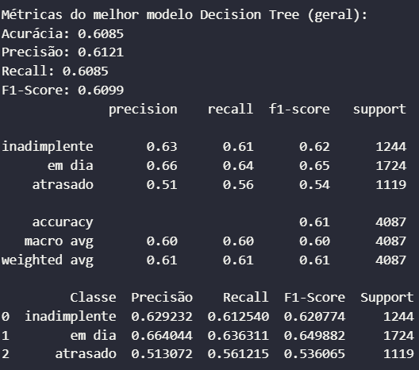
</div>
<br>
<div align="center">
<sup>Fonte: Produzido pelo grupo The Seven, 2025.</sup>
</div>
<br>

&nbsp;&nbsp;&nbsp;&nbsp; A partir dos resultados dos testes, podemos identificar uma acurácia de 60%, precisão de 61% e recall geral de 61%. Observando de forma mais específica, é possível observar que o modelo tem mais facilidade em identificar pagamentos em dia (66% de precisão) e inadimplente (63% de precisão) e tem muita dificuldade de identificar corretamente os boletos que irão atrasar (51% de precisão).

&nbsp;&nbsp;&nbsp;&nbsp; Com esse resultado, a conclusão é de que, definimos como próximos passos, buscar novas features e mudar os hiper-parâmetros com o objetivo de alcançar uma melhor acurácia para o modelo preditivo.

#### 4.3.2.4 Gráficos

**Métricas por Classe**

&nbsp;&nbsp;&nbsp;&nbsp; O gráfico acima apresenta a comparação das métricas de avaliação do modelo separadas por classe (inadimplente, em dia e atrasado). Cada grupo mostra os valores de precisão, recall, F1 Score e suporte, permitindo observar como o modelo se comporta em cada categoria. 

<br>
<div align="center">
<sub align="center">Figura 23 – Metricas por Classe.</sub>
</div>
<br>
<div align="center">
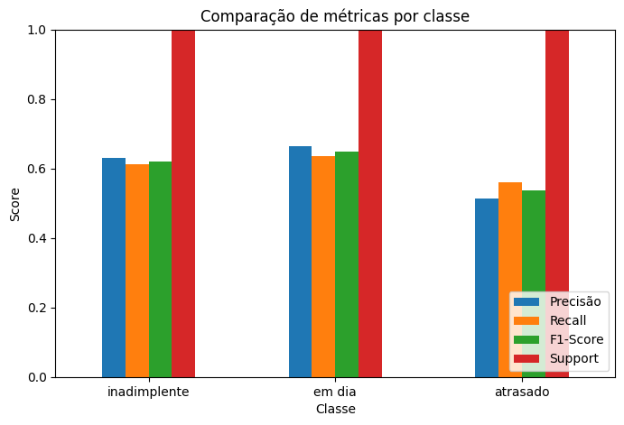
</div>
<br>
<div align="center">
<sup>Fonte: Produzido pelo grupo The Seven, 2025.</sup>
</div>
<br>

&nbsp;&nbsp;&nbsp;&nbsp; Nota-se que as métricas variam de acordo com a classe: enquanto a classe em dia apresenta valores ligeiramente mais altos e consistentes, a classe atrasado tem desempenho inferior, especialmente em precisão, o que indica maior dificuldade do modelo em identificar corretamente os exemplos dessa categoria. Já a classe inadimplente apresenta valores intermediários, com desempenho equilibrado, mas ainda abaixo da classe em dia.

**Matriz de Confusão**

&nbsp;&nbsp;&nbsp;&nbsp; A matriz de confusão apresentada resume o desempenho do modelo de árvore de decisão na classificação das três categorias de status de pagamento: inadimplente, em dia e em atraso.

- **Classe "Em dia":** apresenta o maior número de acertos (1.097 casos classificados corretamente), indicando que o modelo tem maior facilidade em identificar clientes que pagam dentro do prazo.

- **Classe "Inadimplente":** obteve 628 acertos, mas ainda apresenta confusões relevantes, principalmente com a classe "em dia" (307 casos classificados incorretamente).

- **Classe "Em atraso":** alcançou 762 acertos, porém com erros notáveis tanto para "em dia" (248 casos) quanto para "inadimplente" (234 casos), revelando maior dificuldade do modelo em separar corretamente essas categorias.


<br>
<div align="center">
<sub align="center">Figura 24 – Matriz de Confusão.</sub>
</div>
<br>
<div align="center">
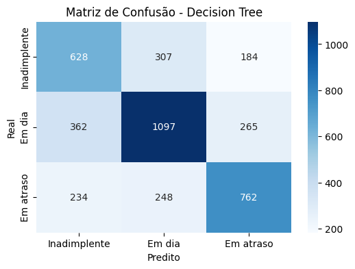
</div>
<br>
<div align="center">
<sup>Fonte: Produzido pelo grupo The Seven, 2025.</sup>
</div>
<br>

&nbsp;&nbsp;&nbsp;&nbsp; De forma geral, observa-se que o modelo consegue distinguir razoavelmente bem as três classes, mas tende a confundir inadimplentes e em atraso com a classe em dia, o que pode impactar decisões práticas, já que esses grupos têm comportamentos de risco diferentes.

#### 4.3.2.5 Conclusão

&nbsp;&nbsp;&nbsp;&nbsp; O modelo consegue prever tendências gerais de pagamento, mas tem um baixo desempenho entre as classes, acertando mais as majoritárias (“em dia”) e confundindo as minoritárias (“inadimplente” e “atrasado”). Após remover variáveis com data leakage como **vl_pagto**, **vl_ratio** e **dias_para_pagar**, a acurácia caiu, mas o modelo passou a generalizar melhor. Gráficos e matriz de confusão mostram claramente onde ele acerta e erra, indicando que há espaço para melhorar com features históricas ou modelos mais robustos.

&nbsp;&nbsp;&nbsp;&nbsp; Como próximos passos para este modelo preditivo, definimos melhorar a acurácia do modelo, para garantir uma maior taxa de acertos nas previsões e usar os dados de todas as tabelas disponibilizadas pela empresa parceira, assim acrescentando valor ao produto oferecido e entregando melhores resultados ao projeto. 

### 4.3.3 Modelo de Previsão de Recebimentos

#### 4.3.3.1 Features Escolhidas

#### 4.3.3.2 Criação do Modelo 

#### 4.3.3.3 Métricas e Testes


### 4.4. Comparação de Modelos

Para aprimorar os modelos e garantir que os algoritmos e hiperparâmetros selecionados sejam os mais adequados, é fundamental definir métricas de avaliação que possibilitem a criação e a comparação entre diferentes abordagens. O uso dessas métricas torna a comparação dos modelos mais eficaz e fornece uma base sólida para a escolha das features, hiperparâmetros e algoritmos mais apropriados.

#### 4.4.1 Modelo de tendência de pagamento
Esse modelo tem como objetivo classificar os pagamentos em três categorias:

- Inadimplente

- Em atraso

- Em dia

Devido à natureza do problema, as métricas utilizadas para avaliação desse modelo são mais específicas e exigem uma análise detalhada. Para isso, utiliza-se a matriz de confusão como base para a escolha e interpretação dos resultados.

##### 4.4.1.A Inadimplente

Caso um pagador inadimplente seja erroneamente classificado como adimplente, a empresa pode acabar aprovando uma compra que não será paga. Por esse motivo, a revocação (recall) é a métrica mais importante para essa categoria.
A revocação corresponde à razão entre os verdadeiros positivos e a soma dos verdadeiros positivos com os falsos negativos, ou seja, o número de inadimplentes corretamente identificados pelo sistema em relação ao total de inadimplentes existentes.

##### 4.4.1.B Em dia

Nesta categoria, os boletos classificados como “em dia” tendem a ter suas compras aprovadas. Assim, erros de classificação podem fazer com que boletos de pagadores inadimplentes sejam emitidos e não pagos. Por isso, a métrica mais relevante é a precisão (precision), que corresponde à razão entre os verdadeiros positivos e a soma dos verdadeiros positivos com os falsos positivos, ou seja, o número de pagamentos corretamente classificados como “em dia” em relação ao total de pagamentos previstos como “em dia”.

##### 4.4.1.C Em atraso

A lógica de classificação para pagamentos em atraso segue o mesmo raciocínio da categoria “em dia”. Erros nesse caso também podem fazer com que boletos de inadimplentes tenham suas compras aprovadas. Dessa forma, a métrica mais apropriada é novamente a precisão (precision), que mede a proporção de boletos corretamente identificados como pagos com atraso em relação ao total de boletos classificados como pagamento em atraso.

#### 4.4.2 Modelo de fluxo de caixa

Esse modelo tem como objetivo prever o valor total de recebimentos do grupo e, para avaliar sua eficácia, é utilizada uma métrica que compara o valor previsto com o valor real, permitindo quantificar seu desempenho. Dessa forma, um aumento nesse indicador representa uma melhora na qualidade do modelo. Por esse motivo, essa métrica foi adotada como base para sua avaliação.

#### 4.4.3 Explicabilidade

O **Modelo B de tendência de pagamento** foi escolhido para ser explicado por ser o mais completo, tanto em termos de métodos utilizados quanto de features selecionadas ou criadas.

**Contexto:**  
Este modelo tem como objetivo prever a tendência de pagamento de um boleto, sendo classificado em três principais categorias: **em dia**, **em atraso** e **inadimplente**.

**Features:**  
Para treinar um modelo é necessário selecionar as **variáveis independentes (X)** que serão utilizadas para realizar a previsão, além da **variável dependente (y)**, que representa o valor a ser previsto.  
Neste modelo, as variáveis **X** utilizadas foram:  
- valor do boleto,  
- quantidade de acessos do pagador,  
- hash da inscrição do pagador,  
- juros,  
- mês do vencimento,  
- dia do vencimento,  
- tipo do pagador (CPF ou CNPJ).  

A variável **y** é o **status do pagamento**.

**Balanceamento dos dados:**  
Em muitos cenários de treinamento, as classes da variável **y** não estão igualmente representadas, gerando um **desbalanceamento**. Isso pode levar o modelo a ter uma "falsa precisão".  
Por exemplo: ao escolher uma letra aleatória do alfabeto, a chance de ser uma vogal é naturalmente menor que a de ser uma consoante. Se um modelo previsse sempre "consoante", ele pareceria estar correto na maioria dos casos, mas estaria enviesado.  
Para corrigir esse problema, foi utilizada a técnica **SMOTE (Synthetic Minority Over-sampling Technique)**, que gera amostras sintéticas das classes minoritárias, equilibrando os dados e reduzindo previsões "corretas" baseadas apenas na sorte.

**Algoritmo utilizado:**  
O algoritmo escolhido foi o **Random Forest**, que combina diversas árvores de decisão para gerar a previsão. A escolha se deu pelo fato de o primeiro modelo ter utilizado apenas uma árvore de decisão; logo, aumentar o número de árvores tende a aumentar a robustez e a precisão das previsões.

**Hiperparâmetros:**  
Hiperparâmetros são configurações que controlam como o modelo aprende, podendo influenciar positivamente ou negativamente o desempenho. Eles ajudam a evitar *overfitting*, balancear respostas e controlar a complexidade do modelo.  
Os hiperparâmetros utilizados foram:  
- **max_depth:** profundidade máxima da árvore, ou seja, quantos níveis de divisão podem ser feitos.  
- **min_samples_split:** número mínimo de amostras necessárias para dividir um nó.  
- **min_samples_leaf:** número mínimo de amostras em um nó folha (nó terminal).  
- **criterion:** função usada para medir a qualidade da divisão (ex.: `gini` ou `entropy`).  

**Visualização (gráficos):**  
Modelos preditivos retornam grande volume de dados, por isso é essencial utilizar gráficos para facilitar a interpretação. Os gráficos utilizados neste modelo foram:  
- **Gráfico de colunas:** para visualizar as métricas de cada categoria de status de pagamento.  
- **Mapa de calor da matriz de confusão:** para mostrar de forma clara como cada dado foi previsto em relação ao seu status real.

### 4.5. Avaliação

```
- Descreva a solução final de modelo preditivo e justifique a escolha. Alinhe sua justificativa com a Seção 4.1, resgatando o entendimento
  do negócio e das personas, explicando de que formas seu modelo atende os requisitos e definições.
- Descreva também um plano de contingência para os casos em que o modelo falhar em suas predições.
- Além disso, discuta sobre a explicabilidade do modelo (se aplicável) e realize a verificação de aceitação ou refutação das hipóteses.
- Se aplicável, utilize equações, tabelas e gráficos de visualização de dados para melhor ilustrar seus argumentos.

Remova este bloco ao final
```

## <a name="c5"></a>5. Conclusões e Recomendações

```
Escreva, de forma resumida, sobre os principais resultados do seu projeto e faça recomendações formais ao seu parceiro de negócios em relação ao uso desse modelo. Você pode aproveitar este espaço para comentar sobre possíveis materiais extras, como um manual de usuário mais detalhado na seção “Anexos”. Não se esqueça também das pessoas que serão potencialmente afetadas pelas decisões do modelo preditivo e elabore recomendações que ajudem seu parceiro a tratá-las de maneira estratégica e ética.

Remova este bloco ao final
```

## <a name="c6"></a>6. Referências

## <a name="attachments"></a>Anexos

```
Utilize esta seção para anexar materiais como manuais de usuário, documentos complementares que ficaram grandes e não couberam no corpo do texto etc.

Remova este bloco ao final
```
### 6.1. Análise de Normalidade e Escalonamento das Variáveis

Para compreender o comportamento estatístico dos dados e prepará-los para as etapas seguintes da análise, foram aplicados dois procedimentos principais: a verificação da normalidade das distribuições e o escalonamento das variáveis. A seguir, cada um desses processos é detalhado. Segue abaixo um glossário explicando palavras chaves que serão usadas posteriormente:

**Hipótese Nula (H₀)**
É o ponto de partida em testes estatísticos e só é rejeitada caso haja evidências suficientes (p ≤ α).

**Hipótese Alternativa (H₁)**
Afirmação contrária à hipótese nula, indicando que a variável não segue uma distribuição normal.

**Nível de Significância (α)**
Critério usado para aceitar ou rejeitar H₀. No estudo, foi adotado α = 5%, valor historicamente usado em testes estatísticos.

**p-valor**
Probabilidade de observar os resultados obtidos (ou mais extremos) caso H₀ seja verdadeira. É comparado com α para decidir a rejeição ou não da hipótese nula.

**Kolmogorov–Smirnov (KS)**
Teste estatístico que compara a distribuição empírica de uma amostra com uma distribuição teórica (como a normal). Requer que média e desvio padrão da população sejam conhecidos.

**Lilliefors**
Adaptação do teste KS usada quando a média e o desvio padrão precisam ser estimados da própria amostra. É o mais adequado quando se trabalha com dados amostrais.

**Histograma**
Gráfico de barras usado para representar a frequência de valores de uma variável, permitindo avaliar visualmente a forma da distribuição.

**Assimetria**
Condição em que a distribuição não é equilibrada em torno da média. No caso estudado, predominou a assimetria à direita (valores altos deslocando a média).

**Média ($\mu$)**
Métrica de tendência central calculada pela soma de todos os valores dividida pelo número de observações. Sensível a outliers.

**Mediana**
Valor central de uma distribuição ordenada. É mais robusta a outliers do que a média, sendo útil para identificar assimetrias.

**Desvio Padrão ($\sigma$)**
Medida de dispersão dos dados em relação à média. Desvios altos indicam grande variabilidade.

**Outliers**
Valores atípicos que se distanciam significativamente do padrão dos demais dados, podendo distorcer média e desvio padrão.

**Escalonamento**
Transformação aplicada às variáveis para ajustá-las a uma mesma escala, facilitando comparações e evitando que variáveis com grande amplitude dominem a análise.

**Normalização Min-Max**
Técnica de escalonamento que transforma valores para o intervalo [0,1], preservando a forma da distribuição original e reduzindo o impacto de amplitudes diferentes.

**Normalidade**
Característica de distribuições que seguem o padrão da curva normal (ou gaussiana), simétrica e em formato de sino.

#### 6.1.1. Análise de Normalidade

Nesta subseção, são apresentados os testes estatísticos utilizados para avaliar se as variáveis seguem uma distribuição normal. A análise da normalidade é fundamental, pois influencia diretamente na escolha dos métodos estatísticos e de modelagem que podem ser aplicados de forma adequada.

##### 6.1.1.1. Afirmações e suas hipóteses

Nesta subseção, são definidas as afirmações e hipóteses que orientam a verificação de normalidade das variáveis analisadas. Para cada variável quantitativa, estabelece-se a hipótese nula (H₀), que pressupõe a normalidade da distribuição, e a hipótese alternativa (H₁), que refuta essa condição. Esse procedimento fornece a base estatística necessária para a aplicação dos testes de normalidade.

1. Afirmação: a variável valor do boleto (`vl_boleto`) não segue uma distribuição normal.
- Hipótese nula (H₀): o valor do boleto segue distribuição normal.
- Hipótese alternativa (H₁): o valor do boleto não segue distribuição normal.

2. Afirmação: a variável valor pago (`vl_pagto`) não segue uma distribuição normal.
- Hipótese nula (H₀): o valor pago segue distribuição normal.
- Hipótese alternativa (H₁): o valor pago não segue distribuição normal.

3. Afirmação: a variável valor do juros (`juros`) não segue uma distribuição normal.
- Hipótese nula (H₀): o valor do juros segue distribuição normal.
- Hipótese alternativa (H₁): o valor do juros não segue distribuição normal.

4. Afirmação: a variável quantidade de acessos (`qtd_acessos_pagador`) não segue uma distribuição normal.
- Hipótese nula (H₀): o quantidade de acessos segue distribuição normal.
- Hipótese alternativa (H₁): o quantidade de acessos não segue distribuição normal.

5. Afirmação: a variável valor da multa (`multa`) não segue uma distribuição normal.
- Hipótese nula (H₀): o valor da multa segue distribuição normal.
- Hipótese alternativa (H₁): o valor da multa não segue distribuição normal.

Observação: H₀ sempre assumirá normalidade, o teste irá indicar se a hipótese nula será rejeitada ou se não há evidências o suficiente para isso.

Assim, nesta etapa foram organizadas as afirmações e hipóteses de cada variável relevante ao estudo, sempre considerando H₀ como a suposição de normalidade. A partir dessa estrutura, torna-se possível avaliar se os dados seguem ou não uma distribuição normal, servindo de suporte para as análises subsequentes.

##### 6.1.1.2. Nível de significância e sua relação com o valor de p

Na análise estatística, o nível de significância ($\alpha$) e o p-valor caminham juntos no processo de tomada de decisão. O nível de significância é um critério fixo, definido antes da análise, e neste estudo será o mesmo para todos os testes. Já o p-valor é calculado individualmente em cada caso, representando a probabilidade de observarmos os dados (ou mais extremos) caso a hipótese nula seja verdadeira. A comparação entre o p-valor de cada teste e o $\alpha$ fixo orienta a decisão sobre a normalidade dos dados.

$\alpha$ = 5% 

essa escolha de alfa ($\alpha$) é um padrão usado historicamente

**Relação com o valor de p:**

Como o nível de significância ($\alpha$) é fixo, a regra de decisão é a mesma para todas as variáveis.  
O p-valor, por sua vez, varia de acordo com cada teste; a comparação é sempre feita com o mesmo $\alpha$.

- Se p $\leq \alpha \rightarrow$ rejeitamos H₀. Portanto, a variável **não segue** distribuição normal.  
- Se p $> \alpha \rightarrow$ não rejeitamos H₀. Portanto, a variável **pode seguir** distribuição normal.

Portanto, ao adotar $\alpha = 5%$, seguimos um padrão amplamente utilizado. A comparação entre o p-valor de cada teste e esse limite fixo indica, de forma uniforme, se rejeitamos a hipótese nula de normalidade ou se os dados podem ser compatíveis com uma distribuição normal.

##### 6.1.1.3. Teste de Normalidade das Variáveis Quantitativas

A verificação da normalidade é um passo essencial para definir quais métodos estatísticos podem ser aplicados de forma adequada. Por isso, todas as variáveis quantitativas passaram por testes formais de normalidade.

O teste adotado para todas as variáveis foi o teste de Lilliefors, que consiste em uma adaptação do teste de Kolmogorov–Smirnov (KS). Enquanto o KS clássico pressupõe que a média ($\mu$) e o desvio padrão ($\sigma$) da população sejam previamente conhecidos, o teste de Lilliefors é adequado quando esses parâmetros precisam ser estimados a partir da própria amostra. Essa escolha se justifica, pois mesmo dispondo de todas as planilhas disponíveis, os dados não seriam suficientes para representar integralmente a população da Finnet, de modo que trabalhamos efetivamente com amostras.

<br>
<div align="center">
<sub align="center">Tabela 1 – Resumo dos Testes de Normalidade</sub>
</div>
<br>
<div align="center">

| Variável   | Teste de Normalidade | Valor de p | Conclusão (α = 0,05)                 |
|------------|----------------------|------------|--------------------------------------|
| valor do boleto | Lilliefors           | 0,0010      | Rejeita H₀ (não segue normalidade)   |
| valor pago | Lilliefors           | 0,0010      | Rejeita H₀ (não segue normalidade)     |
| valor do juros | Lilliefors           | 0,0010      | Rejeita H₀ (não segue normalidade)   |
| quantidade de acessos | Lilliefors           | 0,0010      | Rejeita H₀ (não segue normalidade)   |
| valor da multa | Lilliefors           | 0,0010      | Rejeita H₀ (não segue normalidade)   |

</div>
<br>
<div align="center">
<sup>Fonte: Produzido pelo grupo The Seven, 2025.</sup>
</div>
<br>

Os resultados indicam que, para todas as variáveis analisadas, a hipótese nula de normalidade foi rejeitada ao nível de significância de 5%. Assim, os dados não seguem distribuição normal, o que orienta o uso de técnicas estatísticas que não dependam dessa suposição.

##### 6.1.1.4. Teste de Normalidade das Variáveis Quantitativas

Além dos testes estatísticos aplicados, foram elaborados histogramas para cada uma das cinco variáveis, a fim de avaliar visualmente a forma das distribuições. Essa análise gráfica permite verificar se os dados apresentam comportamento próximo ao da distribuição normal, reforçando ou contrastando os resultados obtidos nos testes de normalidade.

<br>
<div align="center">
<sub align="center">Figura 23 – Histograma - Valor do Boleto</sub>
</div>
<br>
<div align="center">

</div>
<br>
<div align="center">
<sup>Fonte: Produzido pelo grupo The Seven, 2025.</sup>
</div>
<br>

O histograma da variável valor do boleto não apresenta uma distribuição próxima da normal. Observa-se ausência de cauda à esquerda, indicando assimetria na distribuição dos dados.

<br>
<div align="center">
<sub align="center">Figura 24 – Histograma - Valor Pago</sub>
</div>
<br>
<div align="center">
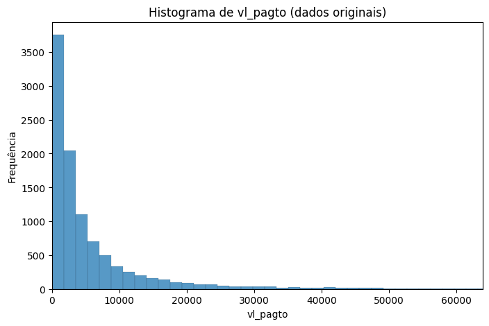
</div>
<br>
<div align="center">
<sup>Fonte: Produzido pelo grupo The Seven, 2025.</sup>
</div>
<br>

O histograma da variável valor pago não apresenta uma distribuição próxima da normal. Observa-se, de forma semelhante ao histograma do valor dos boletos, a ausência de cauda à esquerda, indicando assimetria na distribuição dos dados.

<br>
<div align="center">
<sub align="center">Figura 25 – Histograma - Valor do Juros</sub>
</div>
<br>
<div align="center">

</div>
<br>
<div align="center">
<sup>Fonte: Produzido pelo grupo The Seven, 2025.</sup>
</div>
<br>

O histograma da variável valor dos juros não apresenta uma distribuição compatível com a normal. Nota-se a ausência de cauda à esquerda, além de uma diferença acentuada na frequência entre as primeiras classes, o que reforça a assimetria da distribuição.

<br>
<div align="center">
<sub align="center">Figura 26 – Histograma - Quantidade de Acessos</sub>
</div>
<br>
<div align="center">
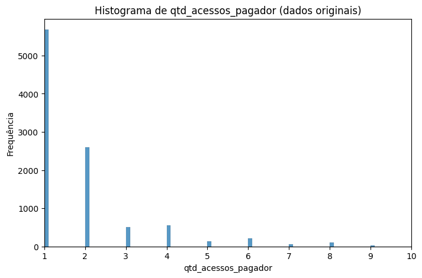
</div>
<br>
<div align="center">
<sup>Fonte: Produzido pelo grupo The Seven, 2025.</sup>
</div>
<br>

De maneira bastante acentuada, o histograma da variável quantidade de acessos se distancia do padrão de uma distribuição normal. Observa-se a ausência de cauda à esquerda e a predominância de colunas à direita com frequências mais elevadas em relação às da esquerda, evidenciando a assimetria da distribuição.

<br>
<div align="center">
<sub align="center">Figura 27 – Histograma - Valor da Multa</sub>
</div>
<br>
<div align="center">
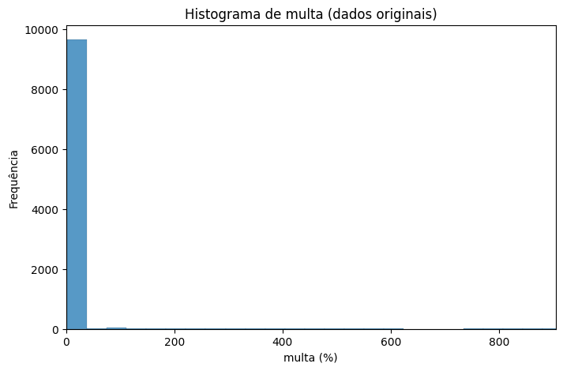
</div>
<br>
<div align="center">
<sup>Fonte: Produzido pelo grupo The Seven, 2025.</sup>
</div>
<br>

O histograma da variável valor das multas evidencia um forte desvio em relação à distribuição normal. Observa-se que a primeira coluna possui frequência extremamente elevada, tornando as demais quase imperceptíveis, o que indica forte assimetria e concentração dos dados em valores mais baixos.

A avaliação gráfica confirmou os resultados dos testes estatísticos: em todas as variáveis, os histogramas evidenciaram desvios claros em relação à normalidade, sobretudo pela forte assimetria nas distribuições.

##### 6.1.1.5. Comparação das Média e Medianas

A comparação entre a média e a mediana das variáveis quantitativas fornece informações importantes sobre a simetria das distribuições. Diferenças significativas entre esses dois parâmetros indicam assimetria nos dados e podem reforçar os resultados obtidos nos testes estatísticos de normalidade. Esta análise permite compreender melhor o comportamento das variáveis e identificar desvios que impactam a interpretação dos dados.

1. Valor do Boleto:
A média da variável Valor do Boleto (R$ 8.278,10) é significativamente maior que a mediana (R$ 2.799,24), refletindo a presença de valores extremamente altos e o alto desvio padrão (R$ 46.433,90). Essa diferença evidencia assimetria à direita, reforçando que a distribuição não se aproxima da normalidade, conforme indicado pelos testes estatísticos e pelo histograma.

2. Valor Pago: Na variável Valor Pago, a média (R$ 7.302,77) também supera a mediana (R$ 2.708,33), indicando que a maioria dos pagamentos está concentrada em valores baixos, enquanto poucos pagamentos muito altos elevam a média. O desvio padrão elevado (R$ 30.500,66) reforça a assimetria à direita, confirmando o afastamento da normalidade.

3. Valor do Juros: Para a variável Valor do Juros, a média (R$ 2,76) é maior que a mediana (R$ 0,94) e o desvio padrão (R$ 15,48) indica grande dispersão em relação à maioria dos valores próximos de zero. Essa diferença evidencia assimetria à direita e a não conformidade com uma distribuição normal.

4. Quantidade de acessos: A média da variável Quantidade de acessos (1,98) é ligeiramente superior à mediana (1,00) e desvio padrão relativamente baixo (2,20). Isso indica que a maioria dos registros está concentrada em valores próximos de 1, enquanto alguns acessos maiores elevam a média. Esse padrão evidencia assimetria à direita, confirmando que a distribuição não segue a normalidade, em concordância com os resultados dos testes estatísticos e do histograma..

5. Valor da Multa: Na variável multa, a média (44,54) é consideravelmente maior que a mediana (10,00), enquanto o desvio padrão elevado (326,98) revela a presença de poucos valores muito altos que distorcem a distribuição. Essa diferença entre média e mediana indica forte assimetria à direita, reforçando que os dados não apresentam distribuição normal, conforme já observado nos histogramas e nos testes de normalidade.

Ademais, nessa seção também foi utilizado o desvio padrão para dar maior embasamento às conclusões proveninentes da comparação entre média e mediana, uma vez que o desvio padrão é responsável medir o grau de dispersão dos dados em relação a média.

A comparação entre média e mediana, complementada pelo desvio padrão, evidenciou padrões de assimetria em todas as variáveis analisadas, reforçando as conclusões sobre o afastamento da normalidade apontadas pelos testes estatísticos e análises gráficas.

#### 6.1.2. Escalonamento das Variáveis

Aqui, são descritos os procedimentos de escalonamento, como normalização e/ou padronização, aplicados para ajustar variáveis com diferentes escalas. Esse processo garante comparabilidade entre os atributos e contribui para a melhoria do desempenho de algoritmos de aprendizado de máquina e análises comparativas.

##### 6.1.2.1. Escalonamento Escolhido

O escalonamento das variáveis quantitativas tem como objetivo ajustar os dados para que fiquem em uma mesma escala, permitindo comparabilidade entre diferentes medidas e evitando que variáveis com amplitudes maiores influenciem de forma desproporcional os resultados da análise. Esse processo preserva a forma das distribuições originais, mantendo informações sobre assimetrias, concentração de valores e outliers, mas ajustando os valores para facilitar interpretações e aplicações em modelos estatísticos.

Antes da escolha do método, foi realizado o teste de normalidade, cujo resultado indicou que as variáveis não seguem uma distribuição normal. Esse diagnóstico reforçou a opção pela normalização Min-Max, aplicada em todas as variáveis, uma vez que a padronização (Z-score) tende a ser mais adequada para dados aproximadamente normais e poderia ser distorcida pela alta amplitude e presença de outliers observada no conjunto analisado. A normalização, ao restringir os valores para o intervalo [0,1], garante comparabilidade entre as variáveis sem que valores extremos exerçam influência desproporcional sobre o escalonamento.

<br>
<div align="center">
<sub align="center">Tabela 2 – Resumo do Escalonamento das Variáveis</sub>
</div>
<br>
<div align="center">

| Variável               | Escalonamento   | Descrição                                                                                  |
|------------------------|----------------|--------------------------------------------------------------------------------------------|
| valor do boleto         | Normalização   | Valores apresentam grande amplitude e outliers; a normalização ajusta todos os valores para o mesmo intervalo [0,1]. |
| valor pago              | Normalização   | Semelhante ao valor do boleto, possui grande variação entre registros; a normalização permite comparabilidade. |
| valor do juros          | Normalização   | Valores pequenos, mas dispersos; normalização mantém a escala padrão sem depender de média e desvio populacional. |
| quantidade de acessos   | Normalização   | Concentração de registros em valores baixos com alguns valores altos; normalização ajusta a escala e facilita análise. |
| valor da multa          | Normalização   | Presença de poucos valores extremamente altos; normalização preserva a forma da distribuição e ajusta a escala. |

</div>
<br>
<div align="center">
<sup>Fonte: Produzido pelo grupo The Seven, 2025.</sup>
</div>
<br>

O escalonamento aplicado uniformemente às variáveis garantiu comparabilidade entre elas, mantendo as propriedades originais dos dados e preparando-os adequadamente para análises subsequentes.

##### 6.1.2.2. Estatísticas Utilizadas

Nesta subseção, apresentam-se os principais valores estatísticos das variáveis quantitativas que serão utilizados no processo de escalonamento: mínimo, máximo, média, mediana e desvio padrão populacional. Esses parâmetros permitem compreender a amplitude e a dispersão dos dados, servindo de base para ajustar as variáveis a uma escala comparável, preservando a forma das distribuições e facilitando análises subsequentes.

<br>
<div align="center">
<sub align="center">Tabela 3 – Valores Estatísticos</sub>
</div>
<br>
<div align="center">

| Variável               | Mínimo   | Máximo       | Média       | Mediana  | Desvio padrão (populacional) |
|------------------------|----------|-------------|------------|---------|------------------------------|
| vl_boleto              | 0.05     | 3.325.737,15 | 8.278,10   | 2.799,24 | 46.433,90                   |
| vl_pagto               | 0.00     | 1.936.467,04 | 7.302,77   | 2.708,33 | 30.500,66                   |
| juros                  | 0.00     | 1.108,58     | 2,76       | 0,94     | 15,48                        |
| qtd_acessos_pagador    | 1.00     | 86.00        | 1,98       | 1,00     | 2,20                         |
| multa                  | 1.46     | 18.325,01    | 44,54      | 10,00    | 326,98                       |

</div>
<br>
<div align="center">
<sup>Fonte: Produzido pelo grupo The Seven, 2025.</sup>
</div>
<br>

A apresentação das estatísticas descritivas permite interpretar a variabilidade e a amplitude de cada variável, fornecendo o suporte necessário para aplicar o escalonamento de forma consistente e confiável.

##### 6.1.2.3. Equações de Escalonamento

O escalonamento das variáveis quantitativas transforma os dados para uma mesma escala, permitindo comparabilidade entre diferentes medidas e evitando que variáveis com amplitudes maiores tenham influência desproporcional.

O escalonamento foi realizado utilizando a **normalização Min-Max**, que transforma os valores de cada variável para o intervalo [0,1]:

$x_{\text{norm}} = \frac{x - x_{\min}}{x_{\max} - x_{\min}}$

Substituindo os valores mínimos e máximos de cada variável:

- **valor do boleto**:  
$vl\_boleto_{\text{norm}} = \frac{vl\_boleto - 0.05}{3325737.1}$

- **valor pago**:  
$vl\_pagto_{\text{norm}} = \frac{vl\_pagto - 0.00}{1936467.04}$

- **juros**:  
$juros_{\text{norm}} = \frac{juros - 0.00}{1108.58}$

- **quantidade de acessos**:  
$qtd\_acessos\_pagador_{\text{norm}} = \frac{qtd\_acessos\_pagador - 1.00}{85}$

- **multa**:  
$multa_{\text{norm}} = \frac{multa - 1.46}{18323.55}$

Ao aplicar as equações de normalização Min-Max, todos os valores das variáveis foram ajustados para o intervalo [0,1], garantindo consistência na escala sem alterar a estrutura dos dados, permitindo comparações diretas entre diferentes variáveis e suportando análises subsequentes.

##### 6.1.2.4. Histogramas Escalonados E Sua Relação Com Não Escalonados

Nesta subseção são apresentados os histogramas das variáveis após o processo de escalonamento, acompanhados de uma comparação com os histogramas originais. O objetivo é observar de que forma a transformação impacta a distribuição dos dados e identificar se houve alterações relevantes em relação ao padrão anteriormente verificado.

<br>
<div align="center">
<sub align="center">Figura 28 – Histograma - Valor do Boleto Escalonado</sub>
</div>
<br>
<div align="center">
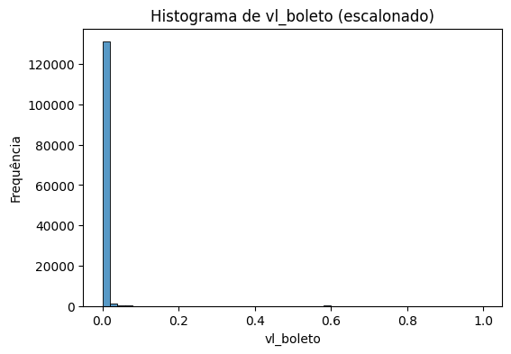
</div>
<br>
<div align="center">
<sup>Fonte: Produzido pelo grupo The Seven, 2025.</sup>
</div>
<br>

Após o processo de escalonamento, o histograma da variável valor do boleto manteve a mesma forma observada antes da transformação, ou seja, não apresentou aproximação a uma distribuição normal. A principal diferença está na escala: os valores, que antes variavam entre 0,05 e 3.325.737,15, foram transformados para o intervalo de 0 a 1. Essa mudança fez com que a concentração dos dados na maior coluna do histograma se tornasse mais evidente, reforçando a assimetria já observada na distribuição original.

<br>
<div align="center">
<sub align="center">Figura 29 – Histograma - Valor Pago Escalonado</sub>
</div>
<br>
<div align="center">
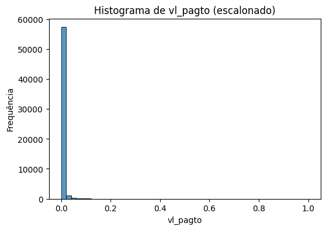
</div>
<br>
<div align="center">
<sup>Fonte: Produzido pelo grupo The Seven, 2025.</sup>
</div>
<br>

Após o processo de escalonamento, o histograma da variável valor pago preservou o mesmo padrão de assimetria observado na distribuição original, sem se aproximar de uma distribuição normal. Assim como ocorreu com a variável valor do boleto, a ausência de cauda à esquerda permaneceu evidente, e a transformação apenas ajustou os dados para o intervalo de 0 a 1. Com isso, a concentração de valores em determinadas faixas tornou-se mais destacada no histograma escalonado, reforçando o comportamento assimétrico já identificado anteriormente.

<br>
<div align="center">
<sub align="center">Figura 30 – Histograma - Valor do Juros Escalonado</sub>
</div>
<br>
<div align="center">
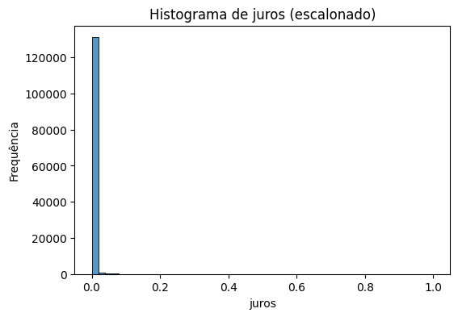
</div>
<br>
<div align="center">
<sup>Fonte: Produzido pelo grupo The Seven, 2025.</sup>
</div>
<br>

Após o escalonamento, o histograma da variável juros manteve o padrão de assimetria identificado na análise original. A ausência de cauda à esquerda continuou presente, assim como a diferença acentuada na frequência das primeiras classes, que se tornou ainda mais evidente no histograma escalonado. A transformação para o intervalo de 0 a 1 não aproximou a distribuição da normalidade, mas destacou a concentração de valores em faixas menores, reforçando o comportamento assimétrico dos dados.

<br>
<div align="center">
<sub align="center">Figura 31 – Histograma - Quantidade de Acessos Escalonado</sub>
</div>
<br>
<div align="center">
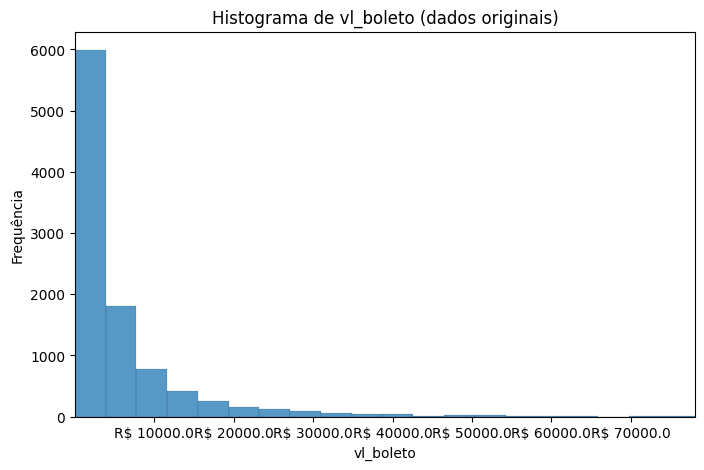
</div>
<br>
<div align="center">
<sup>Fonte: Produzido pelo grupo The Seven, 2025.</sup>
</div>
<br>

Após o escalonamento, o histograma da variável quantidade de acessos manteve a forte assimetria já identificada na análise original. A ausência de cauda à esquerda permaneceu evidente, enquanto a predominância de colunas à direita com maiores frequências tornou-se ainda mais concentrada no novo intervalo de valores. Embora o processo de escalonamento tenha ajustado a escala dos dados, ele não aproximou a variável de uma distribuição normal, reforçando o comportamento assimétrico característico dessa métrica.

<br>
<div align="center">
<sub align="center">Figura 32 – Histograma - Valor da Multa Escalonado</sub>
</div>
<br>
<div align="center">
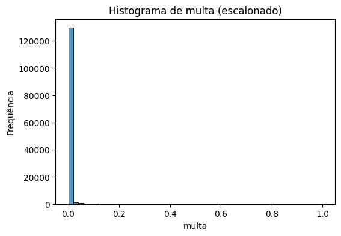
</div>
<br>
<div align="center">
<sup>Fonte: Produzido pelo grupo The Seven, 2025.</sup>
</div>
<br>

Após o escalonamento, o histograma da variável valor das multas manteve o padrão de forte assimetria observado anteriormente. A primeira coluna continuou concentrando a maior parte dos registros, o que torna as demais pouco representativas visualmente. Apesar da alteração na escala, a distribuição permaneceu distante do formato normal, reforçando a predominância de valores muito baixos e a elevada discrepância em relação às classes subsequentes.

Os histogramas escalonados mantiveram o padrão de assimetria e concentração de valores das distribuições originais. A transformação ajustou os dados para o intervalo [0,1] sem modificar a forma geral dos histogramas, confirmando que o escalonamento preservou a estrutura dos dados e reforçou visualmente comportamentos já identificados anteriormente.

##### 6.1.2.5. Tabelas de Dados Originais e Escalonados

Para complementar a análise gráfica dos histogramas, esta subseção apresenta as tabelas com os 10 primeiros registros das variáveis quantitativas utilizadas no estudo, tanto em sua forma original quanto após o processo de escalonamento. Essa comparação possibilita observar, de maneira mais direta, as diferenças entre os valores brutos e os valores transformados, ressaltando como o escalonamento modifica a escala dos dados sem alterar sua estrutura ou relações internas.

As tabelas a seguir apresentam, de forma comparativa, os dez primeiros registros das variáveis quantitativas em sua forma original e após o processo de escalonamento. Essa comparação permite observar as transformações numéricas realizadas pelo método de padronização, sem que haja alteração das relações entre os valores.

<br>
<div align="center">
<sub align="center">Tabela 4 – Valores Originais</sub>
</div>
<br>
<div align="center">

| vl_boleto | vl_pagto | juros | qtd_acessos_pagador | multa |
|-----------|----------|-------|----------------------|-------|
| 8528.52   | 0      | 2.84  | 3.0                  | 10.0  |
| 8528.52   | 8528.52  | 2.84  | 1.0                  | 10.0  |
| 8528.52   | 8528.52  | 2.84  | 3.0                  | 10.0  |
| 8528.52   | 8528.52  | 2.84  | 2.0                  | 10.0  |
| 8528.52   | 8528.52  | 2.84  | 2.0                  | 10.0  |
| 8528.49   | 8528.49  | 2.84  | 2.0                  | 10.0  |
| 726.97    | 726.97   | 0.24  | 1.0                  | 10.0  |
| 726.97    | 726.97   | 0.24  | 1.0                  | 10.0  |
| 726.97    | 0      | 0.24  | 2.0                  | 10.0  |
| 726.97    | 726.97   | 0.24  | 2.0                  | 10.0  |

</div>
<br>
<div align="center">
<sup>Fonte: Produzido pelo grupo The Seven, 2025.</sup>
</div>
<br>

Na tabela dos dados originais, nota-se que as variáveis apresentam magnitudes bastante distintas entre si, o que poderia impactar em análises comparativas e algoritmos que dependem da escala dos valores.

<br>
<div align="center">
<sub align="center">Tabela 5 – Valores Escalonados</sub>
</div>
<br>
<div align="center">

| vl_boleto | vl_pagto | juros   | qtd_acessos_pagador | multa   |
|-----------|----------|---------|----------------------|---------|
| 0.002564  | 0      | 0.002562| 0.023529             | 0.000466|
| 0.002564  | 0.004404 | 0.002562| 0.000000             | 0.000466|
| 0.002564  | 0.004404 | 0.002562| 0.023529             | 0.000466|
| 0.002564  | 0.004404 | 0.002562| 0.011765             | 0.000466|
| 0.002564  | 0.004404 | 0.002562| 0.011765             | 0.000466|
| 0.002564  | 0.004404 | 0.002562| 0.011765             | 0.000466|
| 0.000219  | 0.000375 | 0.000216| 0.000000             | 0.000466|
| 0.000219  | 0.000375 | 0.000216| 0.000000             | 0.000466|
| 0.000219  | 0      | 0.000216| 0.011765             | 0.000466|
| 0.000219  | 0.000375 | 0.000216| 0.011765             | 0.000466|

</div>
<br>
<div align="center">
<sup>Fonte: Produzido pelo grupo The Seven, 2025.</sup>
</div>
<br>

Após o escalonamento, observa-se que os valores passam a estar distribuídos em torno de zero, com variabilidade mais uniforme, o que favorece análises estatísticas e modelos que utilizam essas variáveis de forma conjunta.

### 7. Referências

- MARCAS E MERCADOS. Finnet é homologada para ofertar Pix Automático dentro do Open Finance. Marcas e Mercados, 2024. Disponível em: https://marcasemercados.com.br/finnet-e-homologada-para-ofertar-pix-automatico-dentro-do-open-finance/
. Acesso em: 3 set. 2025.

- BANCO CENTRAL DO BRASIL. Resolução nº 4.595, de 28 de agosto de 2017: dispõe sobre a política de conformidade das instituições autorizadas pelo BCB. Brasília, 2017.

- BANCO CENTRAL DO BRASIL. Brazil Central Bank unveils key fintech and digital currency policies. Fintech Review, Brasília, 2025. Disponível em: https://fintechreview.net/brazil-central-bank-unveils-key-fintech-and-digital-currency-policies/
. Acesso em: 3 set. 2025.

- EY. Próximos desafios e oportunidades do Open Finance no Brasil. EY Insights, 2025. Disponível em: https://www.ey.com/pt_br/insights/open-finance/proximos-desafios-e-oportunidades-open-finance-no-brasil
. Acesso em: 3 set. 2025.

- FINNET. Sobre a Finnet. Finnet, São Paulo, 2024a. Disponível em: https://finnet.com.br/sobre-a-finnet/
. Acesso em: 3 set. 2025.

- LEADIQ. Finnet company profile. Leadiq, 2024. Disponível em: https://leadiq.com/c/finnet/5a1d9b0823000059008a5202
. Acesso em: 3 set. 2025.

- OLHAR DIGITAL. Finnet liderando a transformação digital financeira com inovação empresarial. Olhar Digital, São Paulo, 2024. Disponível em: https://olhardigital.com.br/2024/06/24/pro/finnet-liderando-a-transformacao-digital-financeira-com-inovacao-empresarial/
. Acesso em: 3 set. 2025.

- PwC Brasil; ASSOCIAÇÃO BRASILEIRA DE CRÉDITO DIGITAL. Pesquisa Fintechs de Crédito Digital 2025. São Paulo, 2025. Disponível em: https://www.pwc.com.br/pt/estudos/setores-atividade/financeiro/2025/pesquisa-fintechs-de-credito-digital-2025.html
. Acesso em: 3 set. 2025.

- FALANDO DE NEGÓCIO. “2025 será o ano dos PJs no Open Finance”, acredita Finnet. Falando de Negócio, 30 jan. 2025. Disponível em: https://falandodenegocio.com/2025/01/30/2025-sera-o-ano-dos-pjs-no-open-finance-acredita-finnet/
. Acesso em: 3 set. 2025.

- SERASA EXPERIAN. Inadimplência bate recorde no Brasil com 7,3 milhões de empresas que somam dívidas de quase R$ 170 bilhões, aponta Serasa Experian. Serasa Experian, São Paulo, 2025. Disponível em: https://www.serasaexperian.com.br/sala-de-imprensa/indicadores/inadimplencia-bate-recorde-no-brasil-com-73-milhoes-de-empresas-que-somam-dividas-de-quase-rdollar-170-bilhoes-aponta-serasa-experian/
. Acesso em: 3 set. 2025.

- FOURBANK. Backoffice do futuro: menos planilhas, mais estratégia. Fourbank, 2025. Disponível em: https://www.fourbank.com.br/backoffice-do-futuro-menos-planilhas-mais-estrategia?utm_source=chatgpt.com
. Acesso em: 3 set. 2025.

- INFO MONEY. Pesquisa mostra que 39 % das MPMEs ainda controlam despesas de forma manual. InfoMoney, São Paulo, 2025. Disponível em: https://www.infomoney.com.br/minhas-financas/pesquisa-mostra-que-39-das-mpmes-ainda-controlam-despesas-de-forma-manual/?utm_source=chatgpt.com
. Acesso em: 3 set. 2025.

- RIMINI STREET; KEARNEY. Panorama de uso de ERP no mercado brasileiro (Benchmark Nacional de ERPs). São Paulo, 2024. Disponível em: https://www.riministreet.com/br/press-releases/kearney-panorama-erp-no-mercado-brasileiro/?utm_source=chatgpt.com
. Acesso em: 3 set. 2025.

- ALPHA Level (Significance Level): What is it? Statistics How To. Disponível em: https://www.statisticshowto.com/probability-and-statistics/statistics-definitions/what-is-an-alpha-level/#:~:text=3.,equil%C3%ADbrio%20entre%20esses%20dois%20problemas. Acesso em: 27 ago. 2025.
